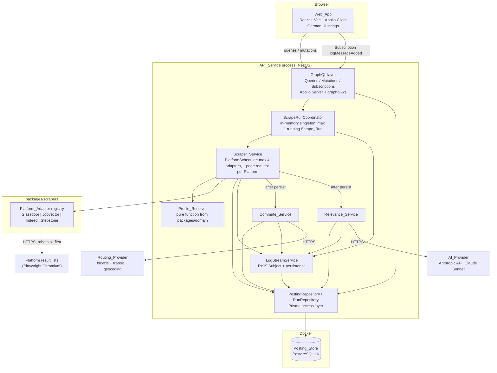
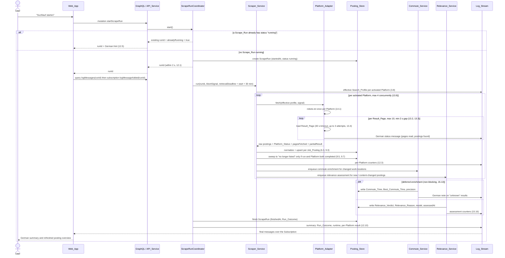

# Design Document

## Overview

The Job_Tool is a locally operated TypeScript monorepo that retrieves Job_Posting from four Platform with
Playwright, normalizes them, stores them in a PostgreSQL Posting_Store, and enriches them with a
Best_Commute_Time from the Routing_Provider and a Relevance_Verdict from the AI_Provider. The single
non-technical user operates everything through the Web_App; a developer changes search criteria by editing
typed constants in the source code.

### Design goals derived from the requirements

| Goal                                                         | Requirement driver              | Consequence for the design                                                                                                                                                                  |
| ------------------------------------------------------------ | ------------------------------- | ------------------------------------------------------------------------------------------------------------------------------------------------------------------------------------------- |
| One command to start everything                              | 1.1 – 1.16                      | A single `scripts/start.mjs` Start_Script orchestrates git, install, Playwright binaries, Docker, Prisma, API_Service, Web_App with ordered readiness gates.                                |
| No cloud, no deployment target                               | 1.16                            | One Node process for the API_Service, one Vite dev server, one PostgreSQL container. No worker process, no message broker.                                                                  |
| Criteria live in code, UI is read-only                       | 3.x, 4.x, 5.x                   | `packages/domain` owns Default_Search_Profile, Platform_Override and the Profile_Resolver; the Web_App renders the resolved result read-only.                                               |
| Compile-time safety for Platform_Override                    | 4.5                             | A generic capability declaration per Platform plus `Partial<Pick<SearchProfile, SupportedFields[number]>>` makes an unsupported Criterion_Field a type error.                               |
| Adding a Platform_Adapter must not touch the Scraper_Service | 6.6                             | One `PlatformAdapter` interface, one exported registry array, injected into the Scraper_Service.                                                                                            |
| Closed status vocabularies                                   | Glossary, 7.4, 9.1, 15.x        | Platform_Status (14 values), Posting_Status (2), Interest_Flag (2), Relevance_Verdict (4), Run_Outcome (3) are modelled as enums in exactly one place and mirrored into Prisma and GraphQL. |
| Verifiable resolution and storage behaviour                  | 5.4 – 5.7, 9.4, 13.7, 15.14     | Profile_Resolver, the upsert path and the AI response parser are pure, Nest-free functions so fast-check can exercise the FOR ALL criteria directly.                                        |
| Degrade instead of fail                                      | 6.x, 7.x, 8.x, 13.x, 14.x, 15.x | Every failure path produces one of the permitted Platform_Status values, retains Partial_Result and lets the Scrape_Run continue.                                                           |

### Text and language convention

This is a hard convention, not a stylistic preference, and it follows Requirement 16.8 and Requirement 2.1:

- English: this design document, `requirements.md`, the Steering_Docs, all source code, all identifiers, all
  code comments, all commit messages, all log message keys.
- German: every string the user reads in the Web_App, every console line of the Start_Script, and every
  Relevance_Reason. Original advertisement text from a Job_Posting is passed through unchanged (2.1).
- All German UI strings live in exactly one typed module, `apps/web/src/i18n/de.ts`, exported as a
  `const` object so that a missing key is a compile error. No German literal appears inside a component.
- Relevance_Reason is produced in German by the AI_Provider because it is user-facing text (15.3); the
  system prompt that asks for it is English (16.7).
- Log_Stream messages are German because the Log_View shows them to the user (12.3). Each message carries an
  English `code` field in its structured detail payload so that tests and developers can assert on a stable
  key instead of on display text.

### Technology stack

| Layer      | Choice                                                                                                | Rationale                                                                                                                                                                    |
| ---------- | ----------------------------------------------------------------------------------------------------- | ---------------------------------------------------------------------------------------------------------------------------------------------------------------------------- |
| Language   | TypeScript 5.x, `strict: true`                                                                        | Required. `any` is banned; the two places where an unavoidable escape hatch exists (Playwright DOM evaluation results, raw AI_Provider JSON) use `unknown` plus a Zod parse. |
| Monorepo   | Turborepo + pnpm workspaces, internal packages as `workspace:*`                                       | Required. Turborepo task graph expresses `build → check-types → test` dependencies between packages.                                                                         |
| Backend    | NestJS + GraphQL code-first with Apollo Server                                                        | Required. One module per feature, thin resolvers, logic in services.                                                                                                         |
| Realtime   | GraphQL Subscription over `graphql-ws`                                                                | One protocol for queries, mutations and the Log_Stream; no second transport to configure.                                                                                    |
| Frontend   | React + Vite, TanStack Router (file-based), Apollo Client, GraphQL Code Generator                     | Required. Generated hooks keep the UI typed against the generated `schema.gql`.                                                                                              |
| Database   | PostgreSQL 16 in Docker, Prisma ORM, `prisma migrate dev`, `prisma-json-types-generator`              | Required. `schema.prisma` is the single source of truth for the database.                                                                                                    |
| Scraping   | Playwright (Chromium)                                                                                 | Required by 6.2. Needed because all four Platform render result lists with client-side JavaScript.                                                                           |
| Validation | Zod                                                                                                   | Used for the environment file, the AI_Provider response and the Routing_Provider responses.                                                                                  |
| Testing    | Vitest, Vitest + jsdom, Playwright E2E, fast-check, `@axe-core/playwright`                            | Required. fast-check carries the FOR ALL criteria.                                                                                                                           |
| Tooling    | ESLint flat config with `eslint-plugin-simple-import-sort`, Prettier (single quotes, trailing commas) | Required.                                                                                                                                                                    |

### Monorepo layout

```text
job-scraper/
├── apps/
│   ├── api/                     NestJS API_Service: GraphQL layer, Prisma, Scraper/Relevance/Commute services
│   │   ├── prisma/schema.prisma single source of truth for the database
│   │   ├── src/prisma/prisma.types.ts  re-export of the generated client (consumers never import @prisma/client)
│   │   └── src/<feature>/       <feature>.module.ts | .resolver.ts | .service.ts | models/ | __tests__/
│   └── web/                     React + Vite Web_App
│       ├── src/routes/          file-based TanStack Router routes (generated routeTree.gen.ts is never edited)
│       ├── src/i18n/de.ts       every German UI string
│       ├── src/graphql/         .graphql operations + generated typed hooks
│       └── e2e/                 Playwright E2E specs
├── packages/
│   ├── domain/                  enums, SearchProfile types, Profile_Resolver, DEFAULT_SEARCH_PROFILE,
│   │                            PLATFORM_CAPABILITIES, PLATFORM_OVERRIDES, PLATFORM_ACTIVATION
│   ├── scrapers/                PlatformAdapter interface, the four adapters, robots.txt handling,
│   │                            normalization, HTML fixtures, PlatformScheduler
│   ├── eslint-config/
│   └── typescript-config/
├── scripts/start.mjs            Start_Script
├── docs/adapters/<platform>.md  one etiquette document per Platform_Adapter (14.7)
├── docker-compose.yml           PostgreSQL container
├── turbo.json
└── .env.example                 every required key with placeholders, no secrets (1.12)
```

Why Profile_Resolver and the Platform_Adapter live outside `apps/api`:

- The Profile_Resolver is the subject of five FOR ALL criteria (5.4 – 5.7, plus 4.3/4.4). As a pure function in
  `packages/domain` it is callable from a fast-check property without a Nest testing module, without a
  database and without mocks, which keeps 100+ iterations per property fast enough to run in CI.
- The Platform_Adapter normalization logic (6.3, 6.4, 6.5, 6.8, 6.9) is the most test-heavy and most fragile
  part of the system. In `packages/scrapers` it can be exercised against frozen HTML fixtures with plain
  Vitest, and the parsing layer stays free of Nest decorators and dependency injection.
- Both packages are also the parts a developer edits most often (criteria constants, selectors). Keeping them
  out of the Nest application makes the blast radius of such an edit visible in the diff.
- The enum and domain type definitions must not be declared twice (project standard), so `packages/domain` is
  the only place that declares them; `apps/api` and `apps/web` import from `@job-scraper/domain`.

Enum parity between `packages/domain` and `schema.prisma` is enforced instead of hoped for: `packages/domain`
declares each closed vocabulary as a `const` tuple plus a derived union type, `schema.prisma` declares the
matching Prisma enum, and `apps/api/src/prisma/__tests__/enum-parity.test.ts` asserts set equality both at
compile time (mutual `satisfies` assignability) and at runtime. This keeps the project rule "enums live in a
shared package" and the Prisma rule "`schema.prisma` is the source of truth for the database" compatible.

### What this design deliberately does not build

- No authentication. The API_Service binds to `127.0.0.1` only and is reachable from the local machine. This
  is a conscious consequence of 1.16 (single developer machine, no cloud). It is called out here because an
  unauthenticated GraphQL endpoint that can start a browser automation run is a real exposure if the host is
  ever put on an untrusted network; the binding to the loopback interface is the only control.
- No multi-user concepts, no roles, no tenant separation (single user per the Introduction).
- No job queue, no Redis, no separate worker (see "Execution model" below).
- No cloud deployment artefacts beyond the local `docker-compose.yml`.

## Architecture

### System overview



### Scrape_Run sequence



### Execution model: background task inside the API_Service process

A Scrape_Run runs as an asynchronous task inside the API_Service process. There is no separate worker
process, no Redis and no job queue.

Rationale (not prescribed by the requirements, so stated explicitly):

- The system serves exactly one user and permits exactly one concurrent Scrape_Run (12.1, 12.5). A queue's
  value — fan-out across workers, retry across restarts, backpressure between producers — has no consumer
  here.
- Requirement 1.16 names the Start_Script and the Web_App as the only entry points. A worker would add a
  third process, a second container and a second failure mode to the Start_Script's ordered readiness gates
  (1.1, 1.11).
- Playwright needs a browser on the same machine anyway, so nothing is gained by moving the work off-process.
- The cost of this choice is explicit: a restart of the API_Service aborts a running Scrape_Run. That is
  acceptable because a Scrape_Run is bounded at 30 minutes (13.6), is cheap to repeat, and already persists
  every Job_Posting incrementally, so a repeat run loses no data (9.3, 9.4).

Single-run enforcement: `ScrapeRunCoordinator` is a Nest singleton that holds
`private activeRun: ActiveRun | null`. `start()` is guarded by an in-process async mutex so that two
near-simultaneous mutations cannot both observe `null`. Because the process is single-threaded and the only
writer, no database advisory lock is needed; a `ScrapeRun` row with `status = RUNNING` is additionally treated
as "occupied" at startup (see recovery below), which closes the gap after a crash.

Cancellation: `ActiveRun` owns an `AbortController`. `cancelScrapeRun` aborts it; every adapter receives the
`AbortSignal`, stops issuing page requests, and the Playwright contexts are closed in a `finally` block. The
coordinator waits at most 10 seconds for the adapters to settle and then force-closes the browser, which
satisfies 12.7.

Deadlines:

- Retrieval deadline: `startedAt + 30 min` (13.6). On expiry no further Platform request is sent, running
  retrievals are ended within 10 seconds, every unfinished Platform gets Platform_Status
  "cancelled by time limit" and the Run_Outcome becomes "cancelled by time limit".
- Enrichment grace deadline: `retrievalEnd + ENRICHMENT_GRACE_MINUTES` (default 10). **This is a design
  decision beyond the requirements.** Requirement 13.6 bounds Platform requests, and 15.13 explicitly keeps
  the runtime limit unaffected by pending assessments, so nothing in the requirements bounds the enrichment
  phase. Without a bound, a hanging Routing_Provider or AI_Provider would keep the Scrape_Run in status
  "running" indefinitely and thereby block 12.1 forever. On expiry, outstanding items stay at Best_Commute_Time
  "unknown" (8.8) and Relevance_Verdict "not assessed" (15.11), a German note goes to the Log_Stream, and the
  Run_Outcome is unaffected.

#### Requirements gap: a Scrape_Run left in status "running" by a process crash

If the API_Service process dies (crash, `Ctrl+C`, machine sleep) while a Scrape_Run is running, the
`ScrapeRun` row keeps `status = RUNNING` and no Run_Outcome. The requirements do not cover this: the glossary
declares the Run_Outcome value list complete and closed with exactly "completed", "cancelled by user" and
"cancelled by time limit", and none of the three describes "the process went away".

Interim behaviour implemented by this design, chosen to stay inside the closed value list:

1. On startup, before the API_Service accepts the first request, `ScrapeRunCoordinator.recoverStaleRuns()`
   selects every `ScrapeRun` with `status = RUNNING`. Because exactly one process ever writes these rows and
   that process has just started, any such row is stale by definition.
2. Each stale run is closed with `finishedAt = now()`, `runOutcome = CANCELLED_BY_TIME_LIMIT` and
   `closedByRecovery = true`.
3. Every Job_Posting already stored by that run is retained unchanged. Because the Run_Outcome is not
   "completed", no Posting_Status sweep happens (9.7) and no Job_Posting is marked "neu" for that run (11.7) —
   which is the correct data semantics.
4. The `closedByRecovery` flag lets the Web_App show an honest German text
   ("Suchlauf durch Neustart beendet") instead of the misleading "Zeitlimit erreicht", without inventing a
   fourth Run_Outcome value.
5. A German-language Log_Stream message records the recovery for that run.

Recommended resolution for the requirements: add a fourth Run_Outcome value (for example
"cancelled by process exit") to the glossary and to Requirement 11, and drop `closedByRecovery`. This gap is
carried into the Risk Assessment.

### Log_Stream

The Log_Stream has two halves that the Web_App stitches together without gaps and without duplicates.

- Write path: every component calls `LogStreamService.emit(...)`. The service assigns a `sequence` number,
  persists a `LogMessage` row and pushes the message into an RxJS `Subject<LogMessage>`.
- Sequence numbers: one in-memory counter per active run, initialised to
  `max(sequence) + 1` for that run (`0` for a fresh run, the stored maximum after a recovery). The counter is
  incremented synchronously before the asynchronous persist, so sequence assignment is strictly monotonic and
  gapless per Scrape_Run even under concurrent emitters. The pair `(runId, sequence)` is unique in the
  database.
- Persistence is required, not optional: Requirement 12.2 demands that at least the last 500 messages stay
  retrievable, and 12.9 demands complete, duplicate-free reload of a running run's history. An in-memory
  buffer cannot satisfy either across a page reload.
- Read path: `logMessages(runId: ID!, afterSequence: Int, limit: Int = 500)` returns history in ascending
  sequence order. The Web_App then opens `logMessageAdded(runId: ID!)` and ignores any message whose
  `sequence` is less than or equal to the highest sequence it already holds. Apollo's cache key for
  `LogMessage` is `['runId', 'sequence']`, so a message delivered twice (reconnect overlap) collapses into one
  cache entry.
- Reconnect: the Web_App reconnects at most five times with at least 2 seconds between attempts (12.11) and,
  after each reconnect, re-runs the history query with `afterSequence = highestSeen` before re-subscribing.
  That ordering is what makes a gap impossible: the subscription may miss messages, the subsequent query
  cannot.
- Retention: messages are never deleted by the application. One Scrape_Run produces on the order of a few
  hundred rows, so growth is irrelevant on a developer machine.

### Concurrency and politeness

Three independent constraints must hold simultaneously: at most 4 Platform_Adapter at a time (13.9), at most
one page request per Platform at a time (13.9), and at least 2 seconds between the end of one page request and
the start of the next for the same Platform — or the robots.txt crawl-delay if that is larger (13.2, 14.4).

Implementation in `packages/scrapers/src/scheduling/`:

- `Semaphore` — a counting semaphore with `acquire(): Promise<Release>`, instantiated with 4 permits by the
  Scraper_Service and wrapped around each adapter run.
- `PlatformQueue` — one instance per Platform. It serialises page requests (a single in-flight slot) and
  records `lastRequestSettledAt` whenever a response arrives or a request is aborted. Before releasing the
  next request it waits `max(0, minDelayMs - (now - lastRequestSettledAt))` where `minDelayMs =
max(2000, crawlDelaySeconds * 1000)`. Measuring from settle time, not from send time, is what 13.2 requires.
- Both are hand-written rather than taken from `p-limit`: the delay bookkeeping is specified behaviour with its
  own property-style tests, and wrapping a library would hide the exact point at which the clock is read.

### Pipeline stages

```text
Fetch (Playwright, per Result_Page)
  → Normalize (pure functions: field limits, ISO 8601 dates, discard/empty rules)
  → Persist (upsert on (platform, postingId), status sweep, counters)
  → Commute enrichment (geocode + Routing_Provider + cache)
  → Relevance assessment (AI_Provider + content hash gate)
```

Fetch and Normalize are separated so that the parsing rules of 6.3 – 6.9 are testable against frozen HTML
fixtures without a browser. Persist is a distinct stage because the idempotence property of 9.4 is a property
of the upsert function alone.

Commute enrichment and Relevance assessment run after persistence and do not block retrieval:

- Requirement 8.1 triggers the commute determination on a Job*Posting that \_is stored*, and Requirement 15.13
  requires a Job_Posting to be visible in the Web_App before its assessment. Both point to enrichment after
  the write.
- Both stages depend on third-party latency that the Job_Tool does not control (10 s routing timeout with up
  to 3 attempts, 30 s AI timeout with up to 2 retries). Putting them in the retrieval path would let a slow
  provider consume the 30-minute retrieval budget of 13.6, which 15.13 forbids.
- Failure isolation: an exhausted Routing_Provider quota leaves Best_Commute_Time "unknown" and an absent AI
  key leaves Relevance_Verdict "not assessed", while retrieval and storage complete normally (8.8, 15.10).

### Playwright operation

- One `chromium.launch({ headless: true })` per Scrape_Run, shared by all adapters. Launching one browser per
  Platform would quadruple memory for no isolation benefit that a context does not already provide.
- One `BrowserContext` per Platform, created with the Job_Tool user agent from the environment file (14.5) and
  a fresh storage state. Separate contexts keep cookies and any sign-in prompt of one Platform out of another.
- Request interception blocks `image`, `font`, `media` and `stylesheet` resource types. This cuts page weight
  substantially and reduces load on the Platform, which supports the etiquette intent of Requirement 14.
- The user agent names the Job_Tool, states private use and carries a contact detail, and it does not imitate
  a common browser (14.5). This increases the probability of being blocked; that trade-off is accepted by the
  requirement and carried into the Risk Assessment.
- Teardown: every page and context is closed in a `finally` block; the shared `AbortSignal` has a listener
  that closes the browser so that a cancellation (12.7) or a deadline (13.6) cannot leave a Chromium process
  behind.
- No credentials are ever supplied, no sign-in or registration form is filled or submitted, and no Captcha is
  answered (7.1, 7.5, 7.6).

## Components and Interfaces

### Closed vocabularies (packages/domain)

```ts
// packages/domain/src/enums.ts
// Each closed value list from the glossary is declared exactly once, as a const tuple plus a derived
// union type. Prisma mirrors these for the database; enum-parity.test.ts asserts the sets are identical.

export const PLATFORMS = [
  "GLASSDOOR",
  "JOBVECTOR",
  "INDEED",
  "STEPSTONE",
] as const;
export type Platform = (typeof PLATFORMS)[number];

export const PLATFORM_STATUSES = [
  "COMPLETED",
  "DISABLED",
  "INCOMPLETE_CONFIGURATION",
  "SIGN_IN_REQUIRED",
  "PLATFORM_BLOCKED",
  "PLATFORM_UNREACHABLE",
  "PAGE_LAYOUT_UNKNOWN",
  "PAGE_LIMIT_REACHED",
  "FETCH_RATE_LIMITED",
  "FAILED",
  "EXCLUDED_BY_ROBOTS_TXT",
  "ROBOTS_TXT_UNAVAILABLE",
  "CANCELLED_BY_TIME_LIMIT",
  "NOT_YET_RUN",
] as const;
export type PlatformStatus = (typeof PLATFORM_STATUSES)[number];

export const POSTING_STATUSES = ["LISTED", "NO_LONGER_LISTED"] as const;
export type PostingStatus = (typeof POSTING_STATUSES)[number];

export const INTEREST_FLAGS = ["UNMARKED", "NOT_INTERESTING"] as const;
export type InterestFlag = (typeof INTEREST_FLAGS)[number];

export const RELEVANCE_VERDICTS = [
  "RELEVANT",
  "NOT_RELEVANT",
  "UNCERTAIN",
  "NOT_ASSESSED",
] as const;
export type RelevanceVerdict = (typeof RELEVANCE_VERDICTS)[number];

export const RUN_OUTCOMES = [
  "COMPLETED",
  "CANCELLED_BY_USER",
  "CANCELLED_BY_TIME_LIMIT",
] as const;
export type RunOutcome = (typeof RUN_OUTCOMES)[number];

export const RUN_STATUSES = ["RUNNING", "FINISHED"] as const;
export type RunStatus = (typeof RUN_STATUSES)[number];

export const COMMUTE_MODES = ["BICYCLE", "TRANSIT"] as const;
export type CommuteMode = (typeof COMMUTE_MODES)[number];

export const COMMUTE_PRECISIONS = ["EXACT", "IMPRECISE", "UNKNOWN"] as const;
export type CommutePrecision = (typeof COMMUTE_PRECISIONS)[number];

// Relevance_Verdict sort order from acceptance criterion 10.7:
// relevant before uncertain before not assessed before not relevant.
export const RELEVANCE_RANK: Readonly<Record<RelevanceVerdict, number>> = {
  RELEVANT: 0,
  UNCERTAIN: 1,
  NOT_ASSESSED: 2,
  NOT_RELEVANT: 3,
};
```

### Search_Profile, capabilities and compile-time safe Platform_Override

This is the core typing of the design. Requirement 4.5 demands that a Platform_Override which sets a
Criterion_Field unsupported by its Platform fails the type check and keeps the build from succeeding. That is
achieved by letting each Platform declare its supported fields as a `const` tuple and deriving the override
type from that tuple.

```ts
// packages/domain/src/search-profile/types.ts

export const EMPLOYMENT_TYPES = [
  "PERMANENT",
  "TEMPORARY",
  "CONTRACT",
  "ANY",
] as const;
export type EmploymentType = (typeof EMPLOYMENT_TYPES)[number];

/** The full set of search criteria. Every Criterion_Field is a key of this interface. */
export interface SearchProfile {
  readonly jobTitle: string;
  readonly titleSynonyms: readonly string[];
  readonly industry: string;
  readonly searchLocation: string;
  readonly searchRadiusKm: number;
  readonly employmentType: EmploymentType;
  readonly publicationPeriodDays: number;
}

export type CriterionField = keyof SearchProfile;

export interface PlatformCapability<
  TSupported extends readonly CriterionField[] = readonly CriterionField[],
  TMandatory extends readonly TSupported[number][] =
    readonly TSupported[number][],
> {
  readonly platform: Platform;
  /** Criterion_Field this Platform can express in its result list query (4.2). */
  readonly supportedFields: TSupported;
  /** Subset of supportedFields the Platform requires to produce a result list (4.2). */
  readonly mandatoryFields: TMandatory;
}

/**
 * Identity helper that preserves the literal tuple types of supportedFields and mandatoryFields.
 * The `const` type parameters make `['jobTitle', 'searchLocation']` stay a tuple of literals instead of
 * widening to `CriterionField[]`, which is what makes the override type below precise.
 * `TMandatory extends readonly TSupported[number][]` already rejects a mandatory field that is not supported.
 */
export function definePlatformCapability<
  const TSupported extends readonly CriterionField[],
  const TMandatory extends readonly TSupported[number][],
>(capability: {
  platform: Platform;
  supportedFields: TSupported;
  mandatoryFields: TMandatory;
}): PlatformCapability<TSupported, TMandatory> {
  return capability;
}

/** A Platform_Override may set only Criterion_Field that its Platform supports (4.1, 4.5). */
export type PlatformOverrideFor<TCapability extends PlatformCapability> =
  Partial<Pick<SearchProfile, TCapability["supportedFields"][number]>>;
```

```ts
// packages/domain/src/search-profile/capabilities.ts

export const PLATFORM_CAPABILITIES = {
  GLASSDOOR: definePlatformCapability({
    platform: "GLASSDOOR",
    supportedFields: [
      "jobTitle",
      "titleSynonyms",
      "searchLocation",
      "searchRadiusKm",
    ],
    mandatoryFields: ["jobTitle", "searchLocation"],
  }),
  JOBVECTOR: definePlatformCapability({
    platform: "JOBVECTOR",
    supportedFields: [
      "jobTitle",
      "titleSynonyms",
      "industry",
      "searchLocation",
      "searchRadiusKm",
    ],
    mandatoryFields: ["jobTitle"],
  }),
  INDEED: definePlatformCapability({
    platform: "INDEED",
    supportedFields: [
      "jobTitle",
      "titleSynonyms",
      "searchLocation",
      "searchRadiusKm",
      "employmentType",
      "publicationPeriodDays",
    ],
    mandatoryFields: ["jobTitle", "searchLocation"],
  }),
  STEPSTONE: definePlatformCapability({
    platform: "STEPSTONE",
    supportedFields: [
      "jobTitle",
      "titleSynonyms",
      "searchLocation",
      "searchRadiusKm",
      "employmentType",
      "publicationPeriodDays",
    ],
    mandatoryFields: ["jobTitle", "searchLocation"],
  }),
} as const satisfies { readonly [P in Platform]: PlatformCapability };

export type PlatformCapabilityMap = typeof PLATFORM_CAPABILITIES;

/** At most one Platform_Override per Platform, at most four in total (4.1). */
export type PlatformOverrideMap = {
  readonly [P in Platform]?: PlatformOverrideFor<PlatformCapabilityMap[P]>;
};
```

```ts
// packages/domain/src/search-profile/constants.ts
// The Default_Search_Profile is exactly one typed constant (3.1). A developer edits this file and restarts
// the API_Service; the change takes effect from the next start (3.9).

export const DEFAULT_SEARCH_PROFILE: SearchProfile = {
  jobTitle: "Projektmanagerin",
  titleSynonyms: [
    "Projektmanager",
    "Project Manager",
    "Projektleiterin",
    "Projektleiter",
    "Project Lead",
    "Teilprojektleiterin",
  ],
  industry: "Pharma and Life Science",
  searchLocation: "München",
  searchRadiusKm: 50,
  employmentType: "PERMANENT",
  publicationPeriodDays: 30,
};

/** Activation per Platform (4.6). A deactivated Platform yields Platform_Status "disabled" (4.7). */
export const PLATFORM_ACTIVATION: Readonly<Record<Platform, boolean>> = {
  STEPSTONE: true,
  JOBVECTOR: true,
  INDEED: true,
  GLASSDOOR: true,
};

export const PLATFORM_OVERRIDES: PlatformOverrideMap = {
  // Stepstone's radius selector offers discrete steps; 30 km keeps the result list focused on Munich.
  STEPSTONE: { searchRadiusKm: 30 },
  // Jobvector is an industry-specific board, so the industry filter is redundant there.
  JOBVECTOR: { searchLocation: "München", searchRadiusKm: 50 },
  // Compile error on purpose if uncommented: GLASSDOOR does not declare `employmentType` as supported.
  // GLASSDOOR: { employmentType: 'PERMANENT' },
};
```

The `PLATFORM_OVERRIDES` declaration above is the mechanism behind Requirement 4.5: because
`PlatformOverrideMap` maps each Platform key to `Partial<Pick<SearchProfile, SupportedFields[number]>>`,
assigning `employmentType` under `GLASSDOOR` produces TS2322 ("Object literal may only specify known
properties") at compile time, and `pnpm check-types` and `pnpm build` both fail. A guard test in
`packages/domain/__tests__/override-typing.test.ts` pins this behaviour with `expect-type`-style `@ts-expect-error`
assertions so that a future refactor cannot silently widen the type.

### Profile_Resolver

A pure function with no Nest dependency, no I/O and no clock access, so that the FOR ALL criteria 5.4 – 5.7
can be driven by fast-check directly.

```ts
// packages/domain/src/search-profile/profile-resolver.ts

export type FieldProvenance = "DEFAULT" | "OVERRIDE";

export interface EffectiveCriterion<K extends CriterionField = CriterionField> {
  readonly field: K;
  readonly value: SearchProfile[K];
  readonly provenance: FieldProvenance;
}

export interface EffectiveSearchProfile {
  readonly platform: Platform;
  /** Exactly one entry per Criterion_Field supported by this Platform (5.4, 5.7). */
  readonly criteria: readonly EffectiveCriterion[];
}

export interface ProfileResolutionError {
  readonly platform: Platform;
  readonly missingMandatoryFields: readonly CriterionField[];
}

export type ProfileResolution =
  | { readonly ok: true; readonly profile: EffectiveSearchProfile }
  | { readonly ok: false; readonly error: ProfileResolutionError };

/**
 * Resolves Default_Search_Profile and the optional Platform_Override of one Platform into exactly one
 * effective Search_Profile (5.1 - 5.3). Returns an error naming the Platform and every missing mandatory
 * Criterion_Field when the resolution is incomplete (5.8).
 *
 * The result lists criteria in the order of `capability.supportedFields`, which makes the returned value
 * deterministic down to list order and therefore comparable by value (5.5).
 */
export function resolveSearchProfile(
  platform: Platform,
  defaults: Partial<SearchProfile>,
  overrides: PlatformOverrideMap,
  capabilities: PlatformCapabilityMap = PLATFORM_CAPABILITIES,
): ProfileResolution;

/** Value-equality used by 5.5: same field names, same value per field, same list order. */
export function effectiveProfilesEqual(
  a: EffectiveSearchProfile,
  b: EffectiveSearchProfile,
): boolean;

/** Stable, human-readable rendering for the Log_Stream (3.7, 3.8). */
export function formatEffectiveProfile(profile: EffectiveSearchProfile): string;
```

`defaults` is typed `Partial<SearchProfile>` rather than `SearchProfile` on purpose: criterion 5.8 describes
the case in which the Default_Search_Profile itself carries no value for a mandatory Criterion_Field, and a
total type would make that case unreachable and the error path untestable.

### Default_Search_Profile validation at startup

```ts
// packages/domain/src/search-profile/validate.ts

export interface ProfileValidationIssue {
  readonly field: CriterionField;
  /** German text for the console, naming the permitted value range (3.6). */
  readonly messageDe: string;
  /** English, stable key for tests and the Log_Stream. */
  readonly code: string;
}

/** Validates against the mandatory fields and value ranges of 3.1, 3.2 and 3.5. */
export function validateDefaultSearchProfile(
  profile: SearchProfile,
): readonly ProfileValidationIssue[];
```

Ranges enforced: `jobTitle`, `industry`, `searchLocation` non-empty and at most 100 characters;
`searchRadiusKm` an integer from 1 to 200; `titleSynonyms` 4 to 20 entries of 2 to 100 characters each;
`publicationPeriodDays` an integer from 1 to 365. The API_Service calls this in a Nest lifecycle hook that
runs before the HTTP listener is bound, prints every issue in German and exits with a non-zero code (3.6).

### PlatformAdapter

```ts
// packages/scrapers/src/adapter/types.ts

/** Raw, unnormalized values as read from a Result_Page. Normalization happens in the Scraper_Service. */
export interface RawJobPosting {
  readonly postingId: string | null;
  readonly title: string | null;
  readonly employer: string | null;
  readonly workLocation: string | null;
  /** Either an ISO date or a platform-specific relative text such as "vor 3 Tagen" (6.4). */
  readonly publishedAtText: string | null;
  readonly sourceUrl: string | null;
  readonly descriptionText: string | null;
}

export interface AdapterLogEvent {
  readonly level: "INFO" | "WARN" | "ERROR";
  /** Stable English key, asserted on in tests. */
  readonly code: string;
  /** German text shown in the Log_View (12.3). */
  readonly messageDe: string;
  readonly pageNumber?: number;
  readonly sourceUrl?: string;
}

export interface AdapterContext {
  readonly runId: string;
  /** Reference point for converting relative dates (6.4). */
  readonly runStartedAt: Date;
  readonly profile: EffectiveSearchProfile;
  /** Opens a page in the BrowserContext of this Platform; the queue enforces 13.2 and 14.4. */
  readonly openPage: () => Promise<Page>;
  /** Max Result_Page per Platform and Scrape_Run (13.3). */
  readonly pageBudget: number;
  /** Per-Result_Page timeout in ms (6.2, 13.4). */
  readonly pageTimeoutMs: number;
  readonly log: (event: AdapterLogEvent) => void;
  readonly signal: AbortSignal;
}

export interface AdapterResult {
  readonly platform: Platform;
  readonly postings: readonly RawJobPosting[];
  readonly platformStatus: PlatformStatus;
  readonly pagesFetched: number;
  /** True when the retrieval ended with a Platform_Status other than "completed" (Partial_Result, 7.7). */
  readonly partialResult: boolean;
}

/** The uniform adapter interface of Requirement 6.6. */
export interface PlatformAdapter<
  TCapability extends PlatformCapability = PlatformCapability,
> {
  readonly capability: TCapability;
  /** The result list entry point, used for the robots.txt evaluation and the adapter documentation (14.1, 14.7). */
  readonly resultListUrl: (
    profile: EffectiveSearchProfile,
    pageNumber: number,
  ) => string;
  fetch(context: AdapterContext): Promise<AdapterResult>;
}
```

Registration without touching the Scraper_Service (6.6):

```ts
// packages/scrapers/src/registry.ts
// Adding a Platform_Adapter means adding one entry here. The Scraper_Service never changes.
export const ALL_PLATFORM_ADAPTERS: readonly PlatformAdapter[] = [
  new StepstoneAdapter(),
  new JobvectorAdapter(),
  new IndeedAdapter(),
  new GlassdoorAdapter(),
];
```

```ts
// apps/api/src/scraper/platform-adapters.provider.ts
export const PLATFORM_ADAPTERS = Symbol("PLATFORM_ADAPTERS");

export const platformAdaptersProvider: Provider = {
  provide: PLATFORM_ADAPTERS,
  useValue: ALL_PLATFORM_ADAPTERS,
};

// Injected as: constructor(@Inject(PLATFORM_ADAPTERS) private readonly adapters: readonly PlatformAdapter[]) {}
```

A Nest multi-injection token is preferred over scanning the file system so that the set of adapters is a
compile-time constant and a typo in a class name is a build error rather than a silently missing Platform.

### Normalization

```ts
// packages/scrapers/src/normalize/normalize-posting.ts

export interface NormalizedJobPosting {
  readonly platform: Platform;
  readonly postingId: string;
  readonly title: string;
  readonly employer: string | null;
  readonly workLocation: string | null;
  readonly publishedAt: Date | null;
  readonly sourceUrl: string;
  readonly descriptionText: string | null;
}

export type NormalizationOutcome =
  | {
      readonly kind: "ACCEPTED";
      readonly posting: NormalizedJobPosting;
      readonly notes: readonly string[];
    }
  /** title, sourceUrl or postingId missing or whitespace only (6.5). */
  | {
      readonly kind: "DISCARDED";
      readonly reason: "MISSING_REQUIRED_FIELD";
      readonly field: string;
    };

export const FIELD_LIMITS = {
  title: 200,
  employer: 150,
  workLocation: 150,
  descriptionText: 10_000,
} as const;

/** Applies 6.3, 6.4, 6.5, 6.8 and 6.9. Pure: the only time input is `runStartedAt`. */
export function normalizePosting(
  platform: Platform,
  raw: RawJobPosting,
  runStartedAt: Date,
): NormalizationOutcome;

/** Converts "vor 3 Tagen", "heute", "gestern", "vor einer Woche" and ISO dates relative to runStartedAt (6.4). */
export function parsePublicationDate(
  text: string | null,
  runStartedAt: Date,
): Date | null;
```

Date handling uses `date-fns` consistently across the whole repository (no mixing with Day.js or Luxon per the
project standard). `date-fns/locale/de` supplies the German relative-date vocabulary the Platform use.

### robots.txt handling

```ts
// packages/scrapers/src/robots/robots.ts

export interface RobotsDecision {
  readonly allowedPaths: readonly string[];
  readonly disallowedPaths: readonly string[];
  readonly crawlDelaySeconds: number | null;
  readonly status: "EVALUATED" | "UNAVAILABLE";
}

/**
 * Fetches and evaluates robots.txt once per Platform and Scrape_Run and caches the decision for the rest of
 * that run (14.1). A fetch that exceeds 10 s or a body that cannot be evaluated yields status UNAVAILABLE,
 * which maps to Platform_Status "robots.txt unavailable" (14.3).
 */
export function evaluateRobots(
  origin: string,
  intendedPaths: readonly string[],
  userAgent: string,
  signal: AbortSignal,
): Promise<RobotsDecision>;
```

`robots-parser` is used for the parsing itself (a well-established, single-purpose package) rather than a
hand-rolled parser, because `Crawl-delay` and user-agent group precedence have enough edge cases to make a
home-grown implementation a liability. The decision is fetched with `fetch`, not with Playwright, so that a
blocked robots.txt does not consume a browser page.

### Scraper_Service and ScrapeRunCoordinator

```ts
// apps/api/src/scrape-run/scrape-run.coordinator.ts

export interface StartScrapeRunResult {
  readonly runId: string;
  /** True when a Scrape_Run was already running; no second run is created (12.5). */
  readonly alreadyRunning: boolean;
}

@Injectable()
export class ScrapeRunCoordinator implements OnApplicationBootstrap {
  /** Closes every ScrapeRun left in status RUNNING by a previous process (requirements gap, see Architecture). */
  async onApplicationBootstrap(): Promise<void>;

  /** Creates at most one running Scrape_Run and returns within 2 s (12.1, 12.5, 12.13). */
  async start(): Promise<StartScrapeRunResult>;

  /** Aborts the running Scrape_Run; rejects when the run is not running (12.7, 12.14). */
  async cancel(runId: string): Promise<{ readonly runOutcome: RunOutcome }>;

  currentRunId(): string | null;
}
```

```ts
// apps/api/src/scraper/scraper.service.ts

export interface PlatformRunResult {
  readonly platform: Platform;
  readonly platformStatus: PlatformStatus;
  readonly pagesFetched: number;
  readonly newPostings: number;
  readonly updatedPostings: number;
  readonly partialResult: boolean;
  readonly missingMandatoryFields: readonly CriterionField[];
}

@Injectable()
export class ScraperService {
  /**
   * Executes every activated Platform_Adapter, at most 4 concurrently (13.9), writes the effective
   * Search_Profile of each Platform to the Log_Stream (3.8) and returns one result per requested Platform.
   */
  async execute(input: {
    readonly runId: string;
    readonly runStartedAt: Date;
    readonly retrievalDeadline: Date;
    readonly signal: AbortSignal;
  }): Promise<readonly PlatformRunResult[]>;
}
```

### PostingRepository

```ts
// apps/api/src/posting/posting.repository.ts

export interface UpsertResult {
  readonly postingId: string;
  readonly created: boolean;
  /** True when title or description text changed, i.e. the content hash differs (15.6). */
  readonly contentChanged: boolean;
}

export interface PostingFilter {
  readonly platforms?: readonly Platform[];
  readonly reachability?: readonly (
    | "WELL_REACHABLE"
    | "NOT_WELL_REACHABLE"
    | "UNKNOWN"
  )[];
  readonly postingStatuses?: readonly PostingStatus[];
  readonly interestFlags?: readonly InterestFlag[];
  readonly relevanceVerdicts?: readonly RelevanceVerdict[];
  readonly firstSeenFrom?: Date;
  readonly firstSeenTo?: Date;
}

export type PostingSortField =
  | "FIRST_SEEN_AT"
  | "PUBLISHED_AT"
  | "BEST_COMMUTE_MINUTES"
  | "RELEVANCE";

export interface PostingSort {
  readonly field: PostingSortField;
  readonly direction: "ASC" | "DESC";
}

@Injectable()
export class PostingRepository {
  /** Upsert on (platform, postingId) per 9.2 and 9.3; idempotent per 9.4. */
  async upsert(
    posting: NormalizedJobPosting,
    runId: string,
    runStartedAt: Date,
  ): Promise<UpsertResult>;

  /** Sets "no longer listed" for absent postings; only called when run and Platform both completed (9.5, 9.7). */
  async markAbsentAsNoLongerListed(input: {
    readonly platform: Platform;
    readonly seenPostingIds: readonly string[];
  }): Promise<number>;

  async findPage(input: {
    readonly filter: PostingFilter;
    readonly sort: PostingSort;
    readonly page: number;
    readonly pageSize: number;
    /** Id of the most recently completed Scrape_Run; drives the "neu" marking and grouping (11.2, 11.3). */
    readonly latestCompletedRunId: string | null;
  }): Promise<{
    readonly items: readonly JobPosting[];
    readonly totalCount: number;
    readonly pageCount: number;
  }>;

  async setInterestFlag(id: string, flag: InterestFlag): Promise<JobPosting>;

  /** Manual override; sets relevanceSetManually = true and survives later Scrape_Run (15.15). */
  async setRelevanceVerdictManually(
    id: string,
    verdict: RelevanceVerdict,
    reasonDe: string | null,
  ): Promise<JobPosting>;

  async writeCommuteResult(id: string, result: CommuteResult): Promise<void>;
  async writeRelevanceResult(
    id: string,
    result: RelevanceResult,
  ): Promise<void>;
}
```

Default view semantics (10.6, 10.11) are applied as a filter default, not as a stored flag: when the client
sends no `relevanceVerdicts` filter, the repository excludes `NOT_RELEVANT`; when it sends no `interestFlags`
filter, it excludes `NOT_INTERESTING`. An explicit filter value always wins, which is what keeps those
postings displayable again.

### LogStreamService

```ts
// apps/api/src/log-stream/log-stream.service.ts

export interface LogMessagePayload {
  readonly runId: string;
  readonly level: "INFO" | "WARN" | "ERROR";
  /** Stable English key. */
  readonly code: string;
  /** German text for the Log_View. */
  readonly messageDe: string;
  readonly platform?: Platform;
  /** Structured context; API keys are masked before this ever leaves the service (14.9). */
  readonly detail?: Readonly<Record<string, unknown>>;
}

@Injectable()
export class LogStreamService {
  /** Assigns a monotonic sequence per runId, persists the row and publishes to subscribers. */
  async emit(payload: LogMessagePayload): Promise<LogMessage>;

  /** History for the Log_View; default limit 500 (12.2, 12.9). */
  async history(
    runId: string,
    afterSequence?: number,
    limit?: number,
  ): Promise<readonly LogMessage[]>;

  /** Subscription source, filtered by runId. */
  stream(runId: string): AsyncIterableIterator<LogMessage>;

  /** Initialises the per-run counter from max(sequence) for that run. */
  async initialiseCounter(runId: string): Promise<void>;
}
```

Secret masking is centralised here and in the error mapper: every value of a key matching
`/key|token|secret|authorization/i` and every substring matching a configured API key is replaced with
`***` before persistence (14.9).

### Commute_Service and the Routing_Provider port

```ts
// apps/api/src/commute/routing-provider.port.ts

export interface Coordinate {
  readonly lat: number;
  readonly lon: number;
}

export interface GeocodeResult {
  readonly coordinate: Coordinate;
  /** IMPRECISE when only a municipality or district centroid could be resolved (8.12). */
  readonly precision: Exclude<CommutePrecision, "UNKNOWN">;
  readonly resolvedName: string;
}

export interface TravelDurationRequest {
  readonly from: Coordinate;
  readonly to: Coordinate;
  readonly mode: CommuteMode;
  /** Arrival reference point for TRANSIT: 09:00 on the next working day (8.1). */
  readonly arriveBy?: Date;
}

/** Port. Swapping the provider must not touch the Commute_Service. */
export interface RoutingProvider {
  readonly name: string;
  geocode(
    freeTextLocation: string,
    signal: AbortSignal,
  ): Promise<GeocodeResult | null>;
  /** Returns whole minutes rounded up, or null when no route could be determined. */
  travelDurationMinutes(
    request: TravelDurationRequest,
    signal: AbortSignal,
  ): Promise<number | null>;
}
```

Provider choice. Two concrete implementations are specified; `ROUTING_PROVIDER` in the environment file
selects one at startup.

- `HeigitRoutingProvider` (default). Bicycle durations come from the
  [openrouteservice Directions service](https://openrouteservice.org/restrictions/) with the `cycling-regular`
  profile, geocoding from the openrouteservice geocoding endpoint, and transit durations from the HeiGIT
  [Public Transit Router](https://heigit.org/introducing-a-new-service-for-public-transport-routing/), which
  does location-to-location routing with an arrival-time preference over a nationwide German GTFS dataset.
  One free account covers all three, the published free standard plan is in the order of 2,000 directions
  requests per day with a per-minute cap, and the data is OpenStreetMap and open GTFS based. For a single user
  producing at most a few hundred new work locations per Scrape_Run, that quota is comfortable, and the cost
  is zero. The arrival-time parameter matters: it is exactly what criterion 8.1 asks for, and a provider
  without it would force a departure-time approximation. Caveat carried into the Risk Assessment: the
  nationwide GTFS feed can be coarser for Munich city transit than the MVV-native data, and the service is
  young. (Content was rephrased for compliance with licensing restrictions.)
- `GoogleRoutingProvider` (alternative). The
  [Google Maps Routes API](https://developers.google.com/maps/documentation/routes/usage-and-billing) plus the
  Geocoding API covers `TRANSIT` with `arrivalTime` and `BICYCLE` in one vendor with the best Munich transit
  data quality. It is pay-as-you-go with a monthly free usage threshold per SKU and a listed price in the
  single-digit-dollars-per-1,000-requests range for the relevant SKUs, so it is affordable at this volume but
  requires a billing account and a daily quota cap in the Cloud Console. (Content was rephrased for compliance
  with licensing restrictions.)

Decision: default to HeiGIT because it needs no billing relationship, which matches the private,
single-machine operating model, and keep the Google implementation behind the same port for the case where
Munich transit accuracy turns out to be insufficient. Both implementations wrap responses in Zod schemas; an
unexpected shape is treated as "no route determined" rather than crashing the enrichment stage.

```ts
// apps/api/src/commute/commute.service.ts

export interface CommuteResult {
  readonly bicycleMinutes: number | null;
  readonly transitMinutes: number | null;
  readonly bestCommuteMinutes: number | null;
  readonly bestCommuteMode: CommuteMode | null;
  readonly precision: CommutePrecision;
  readonly locationInput: string | null;
  readonly checkedAt: Date;
}

@Injectable()
export class CommuteService {
  /**
   * Determines both Commute_Time values and the Best_Commute_Time for one Job_Posting (8.1, 8.2).
   * Order of attempts: cache lookup -> rule-based parse -> stored LocationNormalization ->
   * one AI_Provider normalization (8.6, 8.7) -> geocode -> routing.
   * Values above 600 minutes and every unresolved case become "unknown" (8.2, 8.5, 8.8).
   */
  async enrich(postingId: string, signal: AbortSignal): Promise<CommuteResult>;

  /** Next working day at 09:00 local time, used as the TRANSIT arrival reference (8.1). */
  nextWorkdayArrival(now: Date): Date;

  /** Rule-based extraction of a geocodable place name from a free-text work location (8.5, 8.6). */
  parseWorkLocation(raw: string | null): {
    readonly placeName: string | null;
    readonly reason?: string;
  };
}
```

Caching rules, all implemented in the Posting_Store rather than in memory so they survive a restart:

- `CommuteCacheEntry` keyed by (Home_Address, target latitude, target longitude, CommuteMode) with a 30-day
  `expiresAt` (8.9). Coordinates are rounded to four decimal places (about 11 m) before they enter the key, so
  two postings at the same office building share a cache entry instead of missing each other on floating-point
  noise. That rounding is a design decision; it is well below the precision the requirement cares about.
- `LocationNormalization` keyed by the exact free-text work location string, holding the normalized place name
  and its source (`RULE_BASED` or `AI_PROVIDER`). This is what enforces "at most once per distinct free-text
  work location value" from 8.7, across Scrape_Run and across restarts.
- Re-determination happens when `JobPosting.commuteLocationInput` differs from the current work location value
  (8.5) or when the cached entry has expired, and after a failed determination in the next Scrape_Run (8.8).

### Relevance_Service

```ts
// apps/api/src/relevance/relevance-assessor.port.ts

export const relevanceResponseSchema = z.object({
  verdict: z.enum(["RELEVANT", "NOT_RELEVANT", "UNCERTAIN"]),
  /** German, at most 300 characters (15.3). */
  reason: z.string().min(1).max(300),
});

export type RelevanceResponse = z.infer<typeof relevanceResponseSchema>;

export interface RelevanceRequest {
  readonly title: string;
  readonly employer: string | null;
  readonly workLocation: string | null;
  readonly publishedAt: Date | null;
  /** Truncated to 4,000 characters (15.2). */
  readonly descriptionText: string;
  readonly profile: EffectiveSearchProfile;
}

export type RelevanceOutcome =
  | {
      readonly kind: "ASSESSED";
      readonly response: RelevanceResponse;
      readonly model: string;
    }
  | {
      readonly kind: "FAILED";
      readonly code:
        | "TIMEOUT"
        | "RATE_LIMIT"
        | "TRANSPORT"
        | "SCHEMA_VIOLATION"
        | "NO_API_KEY";
    };

export interface RelevanceAssessor {
  readonly model: string;
  assess(
    request: RelevanceRequest,
    signal: AbortSignal,
  ): Promise<RelevanceOutcome>;
}
```

`AnthropicRelevanceAssessor` details:

- Model from `ANTHROPIC_MODEL`, default `claude-sonnet-4-5`. The model name is stored per assessment (15.1) so
  that a later model change is visible in the data.
- The response shape is forced through tool use: a single tool named `report_relevance` with an input schema
  of `{ verdict: enum, reason: string }` and `tool_choice: { type: 'tool', name: 'report_relevance' }`. The
  model therefore returns a structured tool call rather than prose, which removes the whole class of
  "parse German text for a verdict" failures.
- System prompt (English, per the language convention), with the German output requirement stated explicitly:

  ```text
  You assess German job advertisements for a single candidate.
  Benchmark: the effective Search_Profile given in the user message.
  Decide RELEVANT, NOT_RELEVANT or UNCERTAIN.
  Judge field of expertise, seniority level, work location against the search area, and whether the posting is
  a staffing-agency placement rather than direct permanent employment.
  Call the tool report_relevance exactly once.
  The `reason` value MUST be written in German, MUST be at most 300 characters, and MUST name the concrete
  decisive factor (for example the deviating field of expertise, the deviating seniority level, a work
  location outside the search area, or agency placement instead of permanent employment).
  Do not invent facts that are absent from the advertisement.
  ```

- The tool input is parsed with `relevanceResponseSchema`. Anything that fails the parse — wrong verdict
  value, missing field, reason longer than 300 characters, no tool call at all — becomes
  `SCHEMA_VIOLATION`, and the Job_Posting is stored with Relevance_Verdict `NOT_ASSESSED` plus a Log_Stream
  entry (15.12, 15.14). The schema never produces `NOT_ASSESSED` itself: that value is reserved for the
  Job_Tool's own decisions, which keeps "the model said so" and "we could not get an answer" distinguishable.
- Retry: at most two repetitions with exponential backoff (1 s, 4 s) on `TIMEOUT`, `RATE_LIMIT` and
  `TRANSPORT`; a 30 s per-request timeout via `AbortSignal.timeout` (15.11). `SCHEMA_VIOLATION` is not
  retried, because a second identical request is unlikely to produce a different shape and 15.12 prescribes
  discarding the response.
- Concurrency: `RELEVANCE_CONCURRENCY`, default 4 (15.8). Run budget: `RELEVANCE_MAX_PER_RUN`, default 200
  (15.7). When the budget binds, the remaining postings keep `NOT_ASSESSED` and a German Log_Stream message
  reports the limit. Selection order when the budget binds is oldest `firstSeenAt` first, then `id` —
  deterministic, and not specified by the requirements, so it is stated here.
- No API key or the deactivation switch set: the service is constructed as a `NoopRelevanceAssessor` that
  returns `NO_API_KEY` without a request, every Job_Posting stays `NOT_ASSESSED`, and nothing else in the
  Job_Tool changes behaviour (15.9, 15.10). The landing page states the activation state (14.8).

#### Content hash

Re-assessment is decided by a content hash, not by comparing strings field by field, so that one indexed
column answers the question for 15.5 and 15.6.

```ts
// packages/domain/src/hash/content-hash.ts

/**
 * SHA-256, hex encoded, over the normalized title and description text:
 *   normalize(s) = s.normalize('NFC').replace(/\s+/g, ' ').trim()
 *   payload      = `${normalize(title)}\u0000${normalize(descriptionText ?? '')}`
 * The NUL separator prevents a title/description boundary shift from producing the same hash.
 * Whitespace collapsing keeps irrelevant re-formatting on the Platform from triggering a paid re-assessment.
 */
export function computeContentHash(
  title: string,
  descriptionText: string | null,
): string;
```

Storage: `JobPosting.contentHash` always holds the hash of the currently stored content;
`JobPosting.relevanceContentHash` holds the hash that the stored assessment was based on. A new assessment is
requested exactly when `relevanceSetManually === false` and
(`relevanceContentHash === null` or `relevanceContentHash !== contentHash`). This expresses 15.5, 15.6 and
15.15 in one condition. The same hash is not reused for the commute decision, which keys off the work location
value instead (8.5).

### GraphQL interface

Code-first with decorators; `apps/api/src/schema.gql` is generated by Nest at startup and must never be
hand-edited. The frontend runs GraphQL Code Generator against that file plus the `.graphql` operation files to
produce typed hooks next to each operation.

| Kind         | Operation             | Arguments                                                                                           | Returns                                                                                                                                                                |
| ------------ | --------------------- | --------------------------------------------------------------------------------------------------- | ---------------------------------------------------------------------------------------------------------------------------------------------------------------------- |
| Query        | `jobPostings`         | `filter: JobPostingFilterInput`, `sort: JobPostingSortInput`, `page: Int = 1`, `pageSize: Int = 25` | `JobPostingPage!` (`items`, `totalCount`, `pageCount`, `page`)                                                                                                         |
| Query        | `jobPosting`          | `id: ID!`                                                                                           | `JobPosting`                                                                                                                                                           |
| Query        | `searchCriteria`      | —                                                                                                   | `[PlatformSearchCriteria!]!` (per Platform: `platform`, `activated`, `platformStatus`, `criteria: [EffectiveCriterion!]!` with `provenance`, `missingMandatoryFields`) |
| Query        | `scrapeRuns`          | `limit: Int = 20`                                                                                   | `[ScrapeRun!]!`                                                                                                                                                        |
| Query        | `latestScrapeRun`     | —                                                                                                   | `ScrapeRunSummary` (most recently completed run plus the counters of 11.5)                                                                                             |
| Query        | `activeScrapeRun`     | —                                                                                                   | `ScrapeRun`                                                                                                                                                            |
| Query        | `logMessages`         | `runId: ID!`, `afterSequence: Int`, `limit: Int = 500`                                              | `[LogMessage!]!`                                                                                                                                                       |
| Query        | `appInfo`             | —                                                                                                   | `AppInfo!` (`relevanceServiceActivated`, `homeAddress`, `commuteThresholdMinutes`, `privateUseNoticeDe`)                                                               |
| Mutation     | `startScrapeRun`      | —                                                                                                   | `StartScrapeRunPayload!` (`runId`, `alreadyRunning`, `hintDe`)                                                                                                         |
| Mutation     | `cancelScrapeRun`     | `runId: ID!`                                                                                        | `CancelScrapeRunPayload!` (`runId`, `runOutcome`, `rejectedReasonDe`)                                                                                                  |
| Mutation     | `setInterestFlag`     | `id: ID!`, `flag: InterestFlag!`                                                                    | `JobPosting!`                                                                                                                                                          |
| Mutation     | `setRelevanceVerdict` | `id: ID!`, `verdict: RelevanceVerdict!`, `reasonDe: String`                                         | `JobPosting!`                                                                                                                                                          |
| Subscription | `logMessageAdded`     | `runId: ID!`                                                                                        | `LogMessage!`                                                                                                                                                          |

Notes:

- `JobPosting.isNew` and `JobPosting.bestCommuteLabelDe` are resolved fields, not columns. `isNew` compares
  `firstSeenRunId` with the id of the most recently completed Scrape_Run (11.2, 11.4).
- DataLoader is used for exactly two edges, which are the only places N+1 threatens: `JobPosting.firstSeenRun`
  (a page of 25 postings would otherwise issue 25 run lookups) and `ScrapeRun.platformResults`. Everything
  else on a posting page is a column on the same row.
- Errors are returned as typed payload fields (`hintDe`, `rejectedReasonDe`) rather than as GraphQL errors
  wherever the user is expected to act on them, so that the Web_App can show a German message with exactly one
  recommended next step (2.5) without inspecting `extensions`.
- Subscriptions use `graphql-ws` over `ws`. The server binds to `127.0.0.1`.

### Frontend components and routes

```text
apps/web/src/routes/
├── __root.tsx                 shell, skip link, landing hint of 14.8, global error boundary
├── index.tsx                  landing page: the four named controls of 2.2
├── postings/
│   ├── index.tsx              posting overview: FilterBar, SortSelect, PostingList, Pagination
│   └── $postingId.tsx         detail view: full description text, labelled source link (10.8, 10.15)
├── criteria.tsx               read-only effective Search_Profile per Platform (4.11 - 4.13)
└── runs.$runId.log.tsx        Log_View, rendered as a modal overlay over the current route
```

```text
apps/web/src/components/
├── PostingList/               index.tsx + PostingRow/ + NewBadge/ + CommuteBadge/ + RelevanceBadge/
├── FilterBar/                 index.tsx + PlatformFilter/ + ReachabilityFilter/ + ...
├── LogView/                   index.tsx + LogLine/ + ConnectionNotice/
├── RunSummary/                index.tsx
└── common/                    Button/, Badge/, EmptyState/, ErrorNotice/, Pagination/
```

- `routeTree.gen.ts` is generated by TanStack Router and never edited by hand.
- The Log_View is a route so that it is linkable and reloadable (12.9) but renders as an overlay so that
  closing it returns to the posting overview without interrupting the Scrape_Run (12.8).
- Forms (the filter bar, the manual Relevance_Verdict override) use `react-hook-form`. No XState is
  introduced: the only non-trivial state machine is the Log_Stream connection, and its five-attempt reconnect
  rule (12.11, 12.12) lives in a single `useLogStream` hook with an explicit discriminated-union state, which
  is simpler to read than a machine definition for four states.
- Every status is rendered as text plus an icon with a textual alternative, never colour alone (2.4, 10.4,
  11.2).
- German strings: `apps/web/src/i18n/de.ts`, one `const` object with nested namespaces
  (`de.postings.emptyFilterResult` and so on), typed so a missing key fails `check-types`.

## Data Models

### Prisma schema

`apps/api/prisma/schema.prisma` is the single source of truth for the database. Every change goes through
`pnpm prisma migrate dev --name <change>`; migrations run exactly once in ascending version order and never
drop stored data (9.6).

```prisma
generator client {
  provider = "prisma-client-js"
}

generator json {
  provider = "prisma-json-types-generator"
}

datasource db {
  provider = "postgresql"
  url      = env("DATABASE_URL")
}

enum Platform {
  GLASSDOOR
  JOBVECTOR
  INDEED
  STEPSTONE
}

enum PostingStatus {
  LISTED
  NO_LONGER_LISTED
}

enum InterestFlag {
  UNMARKED
  NOT_INTERESTING
}

enum RelevanceVerdict {
  RELEVANT
  NOT_RELEVANT
  UNCERTAIN
  NOT_ASSESSED
}

/// The 14 permitted Platform_Status values; this list is complete and closed.
enum PlatformStatus {
  COMPLETED
  DISABLED
  INCOMPLETE_CONFIGURATION
  SIGN_IN_REQUIRED
  PLATFORM_BLOCKED
  PLATFORM_UNREACHABLE
  PAGE_LAYOUT_UNKNOWN
  PAGE_LIMIT_REACHED
  FETCH_RATE_LIMITED
  FAILED
  EXCLUDED_BY_ROBOTS_TXT
  ROBOTS_TXT_UNAVAILABLE
  CANCELLED_BY_TIME_LIMIT
  NOT_YET_RUN
}

enum RunStatus {
  RUNNING
  FINISHED
}

/// The three permitted Run_Outcome values; this list is complete and closed.
enum RunOutcome {
  COMPLETED
  CANCELLED_BY_USER
  CANCELLED_BY_TIME_LIMIT
}

enum CommuteMode {
  BICYCLE
  TRANSIT
}

enum CommutePrecision {
  EXACT
  IMPRECISE
  UNKNOWN
}

enum LogLevel {
  INFO
  WARN
  ERROR
}

enum NormalizationSource {
  RULE_BASED
  AI_PROVIDER
}

model JobPosting {
  id String @id @default(uuid())

  // The eight normalized fields of acceptance criterion 6.3.
  platform        Platform
  postingId       String
  title           String    @db.VarChar(200)
  employer        String?   @db.VarChar(150)
  workLocation    String?   @db.VarChar(150)
  publishedAt     DateTime? @db.Timestamptz(3)
  sourceUrl       String
  descriptionText String?   @db.VarChar(10000)

  // Lifecycle (9.1, 11.1, 11.8)
  firstSeenAt    DateTime @db.Timestamptz(3)
  lastSeenAt     DateTime @db.Timestamptz(3)
  firstSeenRunId String
  firstSeenRun   ScrapeRun @relation(fields: [firstSeenRunId], references: [id], onDelete: Restrict)
  postingStatus  PostingStatus @default(LISTED)

  // User marking, independent of postingStatus (Glossary, 10.10)
  interestFlag InterestFlag @default(UNMARKED)

  // Relevance assessment (15.1, 15.5, 15.6, 15.15)
  relevanceVerdict     RelevanceVerdict @default(NOT_ASSESSED)
  relevanceReason      String?          @db.VarChar(300)
  relevanceModel       String?
  relevanceAssessedAt  DateTime?        @db.Timestamptz(3)
  relevanceSetManually Boolean          @default(false)
  /// Sort key derived from relevanceVerdict: relevant < uncertain < not assessed < not relevant (10.7).
  relevanceRank        Int              @default(2)
  /// SHA-256 over normalized title + description text of the currently stored content.
  contentHash          String
  /// contentHash the stored assessment was based on; null when never assessed.
  relevanceContentHash String?

  // Commute (8.2, 8.5, 8.12)
  bicycleMinutes      Int?
  transitMinutes      Int?
  bestCommuteMinutes  Int?
  bestCommuteMode     CommuteMode?
  commutePrecision    CommutePrecision @default(UNKNOWN)
  /// The workLocation value the stored commute result was computed from (8.5).
  commuteLocationInput String?
  commuteCheckedAt    DateTime? @db.Timestamptz(3)

  @@unique([platform, postingId])
  @@index([firstSeenAt(sort: Desc)])
  @@index([firstSeenRunId])
  @@index([platform, postingStatus])
  @@index([postingStatus, interestFlag, relevanceVerdict])
  @@index([bestCommuteMinutes])
  @@index([publishedAt])
  @@index([relevanceRank])
}

model ScrapeRun {
  id         String     @id @default(uuid())
  startedAt  DateTime   @db.Timestamptz(3)
  finishedAt DateTime?  @db.Timestamptz(3)
  status     RunStatus  @default(RUNNING)
  /// Null while status is RUNNING (Glossary).
  runOutcome RunOutcome?
  /// True when this run was closed by the stale-run recovery at API_Service startup (requirements gap).
  closedByRecovery Boolean @default(false)

  platformResults ScrapeRunPlatformResult[]
  logMessages     LogMessage[]
  firstSeenPostings JobPosting[]

  @@index([status])
  @@index([runOutcome, finishedAt(sort: Desc)])
}

model ScrapeRunPlatformResult {
  id        String    @id @default(uuid())
  runId     String
  run       ScrapeRun @relation(fields: [runId], references: [id], onDelete: Cascade)
  platform  Platform

  platformStatus    PlatformStatus
  pagesFetched      Int            @default(0)
  newPostings       Int            @default(0)
  updatedPostings   Int            @default(0)
  partialResult     Boolean        @default(false)
  /// Missing mandatory Criterion_Field names for Platform_Status INCOMPLETE_CONFIGURATION (4.9, 4.10).
  missingMandatoryFields String[]  @default([])
  /// The effective Search_Profile applied to this Platform in this run (3.8).
  /// [EffectiveSearchProfileJson]
  effectiveProfile  Json?

  @@unique([runId, platform])
  @@index([platform])
}

model LogMessage {
  id        String    @id @default(uuid())
  runId     String
  run       ScrapeRun @relation(fields: [runId], references: [id], onDelete: Cascade)
  /// Strictly monotonic per runId, starting at 1; drives gapless reload and deduplication (12.2, 12.4, 12.9).
  sequence  Int
  createdAt DateTime  @db.Timestamptz(3)
  platform  Platform?
  level     LogLevel  @default(INFO)
  /// Stable English key for tests and developers.
  code      String
  /// German text shown in the Log_View (12.3).
  messageDe String
  /// Structured context with every secret already masked (14.9).
  /// [LogMessageDetailJson]
  detail    Json?

  @@unique([runId, sequence])
  @@index([runId, sequence])
}

model CommuteCacheEntry {
  id          String      @id @default(uuid())
  homeAddress String
  /// Target coordinate rounded to 4 decimal places before it enters the key.
  lat         Decimal     @db.Decimal(9, 4)
  lon         Decimal     @db.Decimal(9, 4)
  mode        CommuteMode
  /// Null caches a determined "no route" result for the validity window.
  minutes     Int?
  precision   CommutePrecision
  createdAt   DateTime    @default(now()) @db.Timestamptz(3)
  /// createdAt + 30 days (8.9).
  expiresAt   DateTime    @db.Timestamptz(3)

  @@unique([homeAddress, lat, lon, mode])
  @@index([expiresAt])
}

model LocationNormalization {
  /// The exact free-text work location value as read from the Platform.
  rawLocation    String              @id
  /// Geocodable place name, null when the value stayed unresolvable (8.6).
  normalizedName String?
  lat            Decimal?            @db.Decimal(9, 4)
  lon            Decimal?            @db.Decimal(9, 4)
  precision      CommutePrecision    @default(UNKNOWN)
  source         NormalizationSource
  createdAt      DateTime            @default(now()) @db.Timestamptz(3)
}

/// Last accepted value of each configurable setting, so that an invalid configuration change can be
/// rejected while the previously valid value is retained (8.14).
model Setting {
  key       String   @id
  value     String
  updatedAt DateTime @updatedAt @db.Timestamptz(3)
}
```

### Index rationale

Each index answers a specific requirement, not a guess:

| Index                                                                          | Driven by                                                                                                                                  |
| ------------------------------------------------------------------------------ | ------------------------------------------------------------------------------------------------------------------------------------------ |
| `@@unique([platform, postingId])` on `JobPosting`                              | 9.2 unique key; also the conflict target of the upsert in 9.3 and the idempotence property 9.4.                                            |
| `@@index([firstSeenAt(sort: Desc)])`                                           | 10.7 default sort "recording time descending" and 11.3 within-group sort.                                                                  |
| `@@index([firstSeenRunId])`                                                    | 11.2 "neu" derivation and the 11.5 counters ("first recorded in that run").                                                                |
| `@@index([platform, postingStatus])`                                           | 10.5 Platform filter and the 9.5 sweep, which scans one Platform's `LISTED` rows.                                                          |
| `@@index([postingStatus, interestFlag, relevanceVerdict])`                     | The default view predicate of 10.6 and 10.11 plus the combined filters of 10.5; these three columns appear together in nearly every query. |
| `@@index([bestCommuteMinutes])`                                                | 10.7 sort by Best_Commute_Time and 10.11 / 8.11 reachability filter.                                                                       |
| `@@index([publishedAt])`                                                       | 10.7 sort by publication date.                                                                                                             |
| `@@index([relevanceRank])`                                                     | 10.7 sort by Relevance_Verdict in the prescribed order.                                                                                    |
| `@@unique([runId, sequence])` and `@@index([runId, sequence])` on `LogMessage` | 12.2 and 12.9: fetch the last 500 or everything after a sequence, ordered, without a sort step.                                            |
| `@@index([runOutcome, finishedAt(sort: Desc)])` on `ScrapeRun`                 | 11.2 and 11.5: find the most recently completed Scrape_Run in one index seek.                                                              |
| `@@unique([homeAddress, lat, lon, mode])` on `CommuteCacheEntry`               | 8.9 cache lookup key.                                                                                                                      |
| `@@index([expiresAt])`                                                         | Cheap sweep of expired cache rows.                                                                                                         |

`relevanceRank` exists because PostgreSQL orders an enum by its declaration order, which is not the order
Requirement 10.7 prescribes, and because paginated sorting (10.9) has to happen in SQL rather than in the
application. The alternative — a raw `ORDER BY CASE ... END` query — would take the posting list out of the
Prisma query builder and duplicate the filter logic in SQL strings. The denormalized rank column is written in
the same statement as the verdict (both in `writeRelevanceResult` and in `setRelevanceVerdictManually`), and a
Vitest test asserts `relevanceRank === RELEVANCE_RANK[relevanceVerdict]` for every verdict value, so the two
cannot drift.

### Deriving the "neu" marking without a stored flag

Requirement 11.4 says the marking moves to the postings of the newest completed Scrape_Run and disappears
everywhere else. Maintaining a boolean column would mean a bulk update per run and a chance of a stale `true`
after a crash. Instead:

```sql
-- most recently completed Scrape_Run (11.2)
SELECT id FROM "ScrapeRun"
WHERE status = 'FINISHED' AND "runOutcome" = 'COMPLETED'
ORDER BY "finishedAt" DESC
LIMIT 1;
```

`JobPosting.isNew` is then `firstSeenRunId = :latestCompletedRunId`. Consequences that fall out for free:

- 11.4 needs no write at all: a newer completed run changes the id, so the marking moves on the next read.
- 11.6 is the `latestCompletedRunId IS NULL` case: nothing is marked and the Web_App shows the German hint
  instead of the counters.
- 11.7 holds because a run that ends with another Run*Outcome never becomes the latest \_completed* run, so its
  postings render unmarked.
- 11.8 holds because `firstSeenRunId` is explicitly excluded from the upsert's update set (9.3).
- Default grouping of 11.3 is `ORDER BY ("firstSeenRunId" = :latestCompletedRunId) DESC, "firstSeenAt" DESC`,
  which the `firstSeenRunId` and `firstSeenAt` indexes support.

The 11.5 counters come from the run's `ScrapeRunPlatformResult` rows: new = `SUM(newPostings)`,
sighted again = `SUM(updatedPostings)`, total stored = `COUNT(*)` over `JobPosting`. "Sighted again" is
defined here as an upsert that matched an existing record — the requirements do not define it, so the
definition is pinned in this document and in the repository tests.

### Search_Profile and Platform_Override are code, not data

The Default_Search_Profile, every Platform_Override, the per-Platform capability declaration and the
activation flags are TypeScript constants in `packages/domain` (shown in Components and Interfaces above).
They are deliberately absent from the Prisma schema:

- Requirements 3.1, 3.9, 4.1 and 4.5 require them to be typed constants in the source code whose change takes
  effect on the next start of the API_Service. A database row cannot be type-checked at build time, so 4.5
  would be unimplementable.
- The Web_App presents them read-only (4.13), so there is no write path that would need a table.
- The only persisted trace is `ScrapeRunPlatformResult.effectiveProfile`, a typed JSON snapshot of the profile
  actually applied in that run. That is history, not configuration, and it makes a past run reproducible even
  after the constants change.

Typed JSON columns use `prisma-json-types-generator`: the `/// [EffectiveSearchProfileJson]` and
`/// [LogMessageDetailJson]` annotations bind those columns to interfaces declared in
`apps/api/src/prisma/json-types.d.ts`, which re-export the domain types. Consumers import the generated client
only through `apps/api/src/prisma/prisma.types.ts`.

### Configurable values

Home_Address and Commute_Threshold come from the environment file (1.12) and are validated with Zod at
startup. The last accepted pair is mirrored into the `Setting` table, which is what makes 8.14 implementable:
when the configured Commute_Threshold is not an integer or falls outside 5 to 240, the Job_Tool rejects the
change, keeps the stored previously valid value, and prints a German error naming the permitted range. Without
the `Setting` row there would be no "previously valid value" to retain after a restart. The default pair
("Hörkherstraße 1d, 80689 München", 60) seeds the table on first start (8.10).

## Error Handling

### Principles

- Every failure maps onto one of the 14 permitted Platform_Status values or one of the 3 permitted Run_Outcome
  values. No new status value is invented anywhere in the code; the enum in `packages/domain` is the only
  vocabulary.
- A failure of one Platform never ends the Scrape_Run. The Scraper_Service always executes the remaining
  activated Platform_Adapter to the end (13.1).
- Partial_Result is kept, never discarded (7.7, 13.5, 13.8).
- The user sees a German message with the cause and exactly one recommended next step; technical detail stays
  in the Log_View (2.5). User input is preserved and the action stays repeatable (2.6).
- Errors are mapped once, in `apps/api/src/common/error-mapping.ts`, from an internal discriminated union to
  `{ platformStatus?, runOutcome?, userMessageDe, logCode, logLevel }`. A Vitest test asserts the mapping is
  total over the union, so a new error kind cannot reach the user as an untranslated technical string.
- API keys are masked before any value reaches the Log_Stream or the Web_App (14.9).

### Mapping table

| Error class                                   | Detection                                                                                                       | Behaviour                                                                                                                                                    | Platform_Status / Run_Outcome                                                             | German text for the user                                                                              | Log_Stream entry                                                 |
| --------------------------------------------- | --------------------------------------------------------------------------------------------------------------- | ------------------------------------------------------------------------------------------------------------------------------------------------------------ | ----------------------------------------------------------------------------------------- | ----------------------------------------------------------------------------------------------------- | ---------------------------------------------------------------- |
| robots.txt forbids the intended path          | `evaluateRobots` returns the path in `disallowedPaths` (14.2)                                                   | No page request for that path, no Job_Posting stored for that Platform, remaining Platform continue                                                          | `EXCLUDED_BY_ROBOTS_TXT`                                                                  | "Plattform {Name} wurde nicht abgefragt, weil deren robots.txt den Abruf untersagt."                  | `ERROR` `robots.disallowed` with platform, path                  |
| robots.txt not retrievable or unevaluable     | fetch exceeds 10 s or body cannot be parsed (14.3)                                                              | Platform is not retrieved at all                                                                                                                             | `ROBOTS_TXT_UNAVAILABLE`                                                                  | "Für {Name} konnte die robots.txt nicht geprüft werden; die Plattform wurde übersprungen."            | `ERROR` `robots.unavailable` with platform                       |
| Sign-in required                              | Redirect to a sign-in/registration page, a covering overlay, or 0 readable postings plus a sign-in prompt (7.2) | Retrieval of that Platform ends within 5 s, no further attempt in the same run (7.8), already read postings kept as Partial_Result                           | `SIGN_IN_REQUIRED`                                                                        | "{Name} zeigt Ergebnisse nur nach Anmeldung. Die Trefferliste ist für diese Plattform unvollständig." | `WARN` `platform.signInRequired` with platform, sourceUrl        |
| Captcha or bot check                          | Captcha/bot-check page recognised (7.6)                                                                         | Check is left unanswered, retrieval ends within 5 s, no further attempt in the same run (7.8), Partial_Result kept                                           | `PLATFORM_BLOCKED`                                                                        | "{Name} hat den automatischen Abruf blockiert. Bitte später erneut versuchen."                        | `WARN` `platform.blocked` with platform, sourceUrl               |
| Page layout unknown                           | A Result_Page loads within the time limit but yields no readable Job_Posting (6.7)                              | Retrieval of that Platform ends, run continues unchanged                                                                                                     | `PAGE_LAYOUT_UNKNOWN`                                                                     | "Der Seitenaufbau von {Name} hat sich geändert; es konnten keine Treffer gelesen werden."             | `ERROR` `platform.layoutUnknown` with platform, sourceUrl        |
| Result_Page timeout, retries available        | No response within 30 s (6.10, 13.4)                                                                            | Up to 2 further attempts, at least 2 s apart, at most 3 attempts per Result_Page                                                                             | none yet (retry in progress)                                                              | Progress line: "{Name}: Seite {n} wird erneut abgerufen."                                             | `WARN` `page.retry` with platform, pageNumber, attempt           |
| Result_Page timeout, retries exhausted        | All 3 attempts without a result (13.8)                                                                          | Retrieval of that Platform ends, postings up to that page are passed to the Posting_Store                                                                    | `FAILED`                                                                                  | "{Name} hat auf Seite {n} nicht geantwortet. Treffer bis zu dieser Seite wurden gespeichert."         | `ERROR` `page.failed` with platform, pageNumber                  |
| Platform unreachable                          | Retrieval of a Result_Page unanswered after the permitted repetitions at the transport level (6.10)             | Already read Job_Posting retained                                                                                                                            | `PLATFORM_UNREACHABLE`                                                                    | "{Name} war nicht erreichbar. Bitte den Suchlauf später wiederholen."                                 | `ERROR` `platform.unreachable` with platform                     |
| Fetch rate limited                            | Platform response reports an exceeded fetch rate (13.5)                                                         | No further request to that Platform in this run, normalized postings retained                                                                                | `FETCH_RATE_LIMITED`                                                                      | "{Name} hat die Abfragerate begrenzt. Der Abruf dieser Plattform wurde beendet."                      | `WARN` `platform.rateLimited` with platform, pageNumber          |
| Page limit reached                            | 10th Result_Page retrieved (13.3)                                                                               | Retrieval of that Platform ends normally; this is not a failure                                                                                              | `PAGE_LIMIT_REACHED`                                                                      | "{Name}: Seitenlimit erreicht, es wurden 10 Ergebnisseiten gelesen."                                  | `INFO` `platform.pageLimit` with platform                        |
| Mandatory posting field missing               | title, source URL or Posting_Id missing or whitespace only (6.5)                                                | That Job_Posting is discarded, retrieval continues                                                                                                           | unchanged                                                                                 | Not surfaced individually; counted in the run summary                                                 | `WARN` `posting.discarded` with platform, sourceUrl, field       |
| Optional posting field missing                | employer, work location, publication date or description text absent (6.8)                                      | Field stored as empty, Job_Posting kept                                                                                                                      | unchanged                                                                                 | Detail view shows "Keine Beschreibung vorhanden." for an empty description (10.15)                    | `INFO` `posting.fieldEmpty` with platform, field                 |
| Date parsing failed                           | `parsePublicationDate` returns null for a non-empty text (6.9)                                                  | publication date stored empty, Job_Posting retained                                                                                                          | unchanged                                                                                 | List shows "Datum unbekannt"                                                                          | `WARN` `posting.dateUnparsed` with platform, sourceUrl, raw text |
| Routing_Provider failure or timeout           | No answer within 10 s or an error response (8.8)                                                                | Up to 3 attempts, then Best_Commute_Time "unknown", Job_Posting kept, retried in the next Scrape_Run                                                         | unchanged (enrichment does not set Platform_Status)                                       | Posting shows "Erreichbarkeit unbekannt" (8.13)                                                       | `WARN` `commute.providerFailed` with postingId, mode             |
| Geocoding failed                              | No coordinate from rule-based parsing, stored normalization and at most one AI normalization (8.5, 8.6)         | Best_Commute_Time "unknown", repeat only after the work location value changes                                                                               | unchanged                                                                                 | "Erreichbarkeit unbekannt"                                                                            | `WARN` `commute.geocodeFailed` with postingId, raw location      |
| Work location only municipality-level         | Geocoder returns a municipality or district centroid (8.12)                                                     | Centroid used, values marked `IMPRECISE`                                                                                                                     | unchanged                                                                                 | "Erreichbarkeit ungefähr: {n} Min."                                                                   | `INFO` `commute.imprecise` with postingId                        |
| AI_Provider failure, timeout or rate limit    | Transport error, 30 s timeout or rate-limit response (15.11)                                                    | At most 2 retries with exponential backoff, then Relevance_Verdict `NOT_ASSESSED` with a German note in the Relevance_Reason, run continues                  | unchanged                                                                                 | Badge "nicht bewertet" plus the stored German note                                                    | `WARN` `relevance.requestFailed` with postingId, reason code     |
| AI response violates the schema               | Zod parse of the tool input fails or the verdict is outside the value list (15.12, 15.14)                       | Response discarded, `NOT_ASSESSED` stored, not retried                                                                                                       | unchanged                                                                                 | Badge "nicht bewertet"                                                                                | `ERROR` `relevance.schemaViolation` with postingId               |
| AI run budget reached                         | 200 assessments in this run (15.7)                                                                              | Remaining postings stay `NOT_ASSESSED`                                                                                                                       | unchanged                                                                                 | "Bewertungslimit erreicht: {n} Treffer wurden nicht bewertet."                                        | `INFO` `relevance.budgetReached` with count                      |
| No AI API key / Relevance_Service deactivated | Key absent or switch set (15.9, 15.10)                                                                          | No request at all, every Job_Posting `NOT_ASSESSED`, all other functions unaffected                                                                          | unchanged                                                                                 | Landing page states "KI-Bewertung ist deaktiviert." (14.8)                                            | `INFO` `relevance.disabled`                                      |
| Posting_Store write failure                   | Prisma error on a single upsert (9.9)                                                                           | Affected record left in its pre-write state, remaining postings of the run continue                                                                          | unchanged                                                                                 | Summary names the number of failed writes                                                             | `ERROR` `posting.writeFailed` with platform, postingId           |
| Interest_Flag write failure                   | Prisma error on `setInterestFlag` (10.14)                                                                       | Nothing persisted; posting continues to be listed as `UNMARKED` in the default view                                                                          | unchanged                                                                                 | "Die Markierung konnte nicht gespeichert werden. Bitte erneut versuchen."                             | `ERROR` `posting.interestFlagFailed` with postingId              |
| Retrieval time limit of 30 minutes            | `now >= startedAt + 30 min` (13.6)                                                                              | No further Platform request, running retrievals end within 10 s, stored postings retained, unfinished Platform marked                                        | `CANCELLED_BY_TIME_LIMIT` per unfinished Platform and as Run_Outcome                      | "Zeitlimit von 30 Minuten erreicht. Der Suchlauf wurde beendet."                                      | `WARN` `run.timeLimitReached`                                    |
| Enrichment grace deadline                     | `now >= retrievalEnd + grace` (design decision, see Architecture)                                               | Outstanding enrichment abandoned: commute stays "unknown", relevance stays `NOT_ASSESSED`; Run_Outcome unchanged                                             | unchanged                                                                                 | "Bewertung und Erreichbarkeit konnten nicht für alle Treffer ermittelt werden."                       | `WARN` `run.enrichmentDeadline` with counts                      |
| Cancellation by the user                      | `cancelScrapeRun` on a running run (12.7)                                                                       | Retrievals end within 10 s, stored postings unchanged, end time set                                                                                          | `CANCELLED_BY_USER`; unfinished Platform keep their last reported status or `NOT_YET_RUN` | "Suchlauf abgebrochen." plus the summary                                                              | `INFO` `run.cancelledByUser`                                     |
| Cancellation of a run that is not running     | `cancelScrapeRun` on a finished run (12.14)                                                                     | Cancellation rejected, stored Run_Outcome returned                                                                                                           | unchanged                                                                                 | "Dieser Suchlauf läuft nicht mehr; Ergebnis: {Run_Outcome}."                                          | `INFO` `run.cancelRejected` with runId                           |
| Scrape_Run cannot be created                  | Coordinator or database rejects the creation (12.13)                                                            | No Scrape_Run created, error payload returned                                                                                                                | none                                                                                      | "Der Suchlauf konnte nicht gestartet werden: {Ursache}. Bitte erneut versuchen."                      | `ERROR` `run.createFailed`                                       |
| Second start while a run is running           | `activeRun !== null` (12.5)                                                                                     | No second run; id of the running run returned                                                                                                                | unchanged                                                                                 | "Es läuft bereits ein Suchlauf." plus a link to the Log_View                                          | `INFO` `run.alreadyRunning`                                      |
| Log_Stream connection broken                  | `graphql-ws` close or error event (12.11)                                                                       | Up to 5 reconnects, at least 2 s apart; after each reconnect the history query runs with `afterSequence` before re-subscribing                               | unchanged, Scrape_Run untouched                                                           | "Die Übertragung wurde unterbrochen; es wird erneut verbunden."                                       | Client-side only; the server logs nothing                        |
| Log_Stream reconnect exhausted                | 5 attempts without a connection (12.12)                                                                         | Waiting stops, Scrape_Run untouched                                                                                                                          | unchanged                                                                                 | "Keine Verbindung zum Log. Übertragung erneut verbinden." with that control                           | Client-side only                                                 |
| Invalid Default_Search_Profile constant       | `validateDefaultSearchProfile` returns issues at startup (3.6)                                                  | API_Service stops before accepting the first request, non-zero exit code                                                                                     | none (no process to serve)                                                                | Console: every affected Criterion_Field with its permitted range                                      | Console output; the API_Service never starts                     |
| Incomplete per-Platform configuration         | Mandatory Criterion_Field unresolved for an activated Platform (4.9, 4.10, 5.8)                                 | That Platform is skipped; the remaining Platform keep being served                                                                                           | `INCOMPLETE_CONFIGURATION` plus the missing field names                                   | "{Name}: Konfiguration unvollständig, fehlende Felder: {Liste}."                                      | `ERROR` `platform.incompleteConfiguration` with platform, fields |
| Invalid Commute_Threshold                     | Not an integer or outside 5 to 240 (8.14)                                                                       | Configuration change rejected, previously valid value from `Setting` retained                                                                                | none                                                                                      | "Pendelgrenze muss eine ganze Zahl zwischen 5 und 240 Minuten sein; der bisherige Wert bleibt aktiv." | `ERROR` `config.commuteThresholdInvalid`                         |
| Missing configuration key                     | Zod validation of the environment file fails at Start_Script time (1.15)                                        | No service started, non-zero exit code                                                                                                                       | none                                                                                      | Console: names of all missing keys                                                                    | Console output                                                   |
| Container runtime unreachable                 | Docker probe fails before step 4 (1.13)                                                                         | Start_Script stops, non-zero exit code                                                                                                                       | none                                                                                      | Console: "Container-Laufzeit nicht erreichbar. Bitte Docker starten."                                 | Console output                                                   |
| Prisma migration failed                       | `prisma migrate deploy` exits non-zero (1.14)                                                                   | Neither API_Service nor Web_App started, stored data unchanged                                                                                               | none                                                                                      | Console: name of the failed migration                                                                 | Console output                                                   |
| Service not ready within 60 s                 | Readiness probe every 2 s fails for 60 s (1.11)                                                                 | Remaining steps skipped, non-zero exit code                                                                                                                  | none                                                                                      | Console: affected service plus cause (unreachable or port occupied)                                   | Console output                                                   |
| Process crash with a run left "running"       | `status = RUNNING` row found at startup (requirements gap)                                                      | Run closed with `finishedAt`, `runOutcome = CANCELLED_BY_TIME_LIMIT`, `closedByRecovery = true`; stored postings retained, no status sweep, no "neu" marking | `CANCELLED_BY_TIME_LIMIT` (closest permitted value)                                       | "Suchlauf durch Neustart beendet."                                                                    | `WARN` `run.recoveredStale` with runId                           |

### Failures that are not errors

Two Platform_Status values describe expected, non-error outcomes and must not produce an error-styled message:
`DISABLED` for a Platform deactivated in the source code (4.7) and `NOT_YET_RUN` for a Platform that has not
been requested in the current run. `PAGE_LIMIT_REACHED` is a normal end of retrieval and is logged at `INFO`.
Requirement 7.4 is satisfied by showing exactly one Platform_Status per requested Platform in the summary plus
the hint that the list is incomplete whenever any status differs from `COMPLETED`.

## Correctness Properties

_A property is a characteristic or behavior that should hold true across all valid executions of a system —
essentially, a formal statement about what the system should do. Properties serve as the bridge between
human-readable specifications and machine-verifiable correctness guarantees._

This feature is a good fit for property-based testing because its load-bearing parts are pure functions over
a large input space: the Profile_Resolver, the normalization layer, the date parser, the upsert decision
logic, the commute selection, the AI response parser, the filter/sort/pagination logic and the scheduling
bookkeeping.
Everything that is infrastructure-shaped (Docker, Prisma migrations, Playwright against a live Platform, the
Steering_Docs) is handled by example, integration or smoke tests instead, as classified in the prework.

All properties are implemented with [fast-check](https://fast-check.dev) and run at least 100 iterations
(`fc.assert(..., { numRuns: 100 })`). Each property is implemented by exactly one property-based test, and
each test carries a tag comment in the prescribed form:

```ts
// Feature: job-search-tool, Property 7 - Upsert into the Posting_Store is idempotent
```

### Property 1: Profile resolution is total over the supported fields

_For all_ Platform, _for all_ valid Default*Search_Profile and \_for all* valid Platform_Override, a successful
resolution returns an effective Search_Profile whose field set equals that Platform's `supportedFields`
exactly, with exactly one value per field and no field the Platform does not support.

- Generator: `fc.constantFrom(...PLATFORMS)`, an arbitrary for `SearchProfile` with valid field values, and an
  arbitrary override that picks a random subset of the Platform's supported fields.
- Oracle: `new Set(result.profile.criteria.map(c => c.field))` deep-equals
  `new Set(PLATFORM_CAPABILITIES[platform].supportedFields)`, and `criteria.length` equals that set size.

**Validates: Requirements 5.1, 5.4, 5.7**

### Property 2: Profile resolution is deterministic and idempotent

_For all_ Platform and _for all_ valid combinations of Default_Search_Profile and Platform_Override, resolving
the same inputs repeatedly yields results that are value-equal: identical field-name sets, identical value per
field name and identical order of list elements.

- Generator: as Property 1, plus a repetition count from 2 to 5.
- Oracle: `effectiveProfilesEqual(first, nth)` is true for every repetition, where value-equality compares
  `titleSynonyms` element by element in order.

**Validates: Requirements 5.5**

### Property 3: Every resolved value carries a correct provenance

_For all_ Platform and _for all_ valid combinations of Default_Search_Profile and Platform_Override, each
Criterion_Field of the result is value-equal to the Platform_Override value where the override sets that field
and carries provenance `OVERRIDE`, and is value-equal to the Default_Search_Profile value where the override
leaves it unset and carries provenance `DEFAULT`.

- Generator: as Property 1, with the override subset recorded separately so the oracle knows which fields were
  set.
- Oracle: for each criterion, `criterion.value === (overrideKeys.has(field) ? override[field] : defaults[field])`
  and `criterion.provenance === (overrideKeys.has(field) ? 'OVERRIDE' : 'DEFAULT')`.

**Validates: Requirements 3.4, 4.3, 4.4, 5.2, 5.3, 5.6**

### Property 4: Unresolvable mandatory fields produce a naming error and no profile

_For all_ Platform and _for all_ input combinations in which at least one mandatory Criterion_Field of that
Platform is set neither by the Platform_Override nor by the Default_Search_Profile, the resolution returns no
Search_Profile and returns an error whose missing-field set equals exactly the set of unresolved mandatory
fields and which names the Platform.

- Generator: a Platform, a partial `SearchProfile` with a random subset of keys removed, and an override over
  a random subset of supported fields.
- Oracle: the expected missing set is computed as
  `mandatoryFields.filter(f => override[f] === undefined && defaults[f] === undefined)`; the result is
  `ok: false` with exactly that set iff the set is non-empty, and `ok: true` otherwise.

**Validates: Requirements 4.8, 5.8**

### Property 5: Normalization is total and respects every field limit

_For all_ raw postings read from a Result_Page, normalization returns either an `ACCEPTED` result in which
every field respects its length limit (title 200, employer 150, work location 150, description 10,000) and
every truncated value is a prefix of the input, or a `DISCARDED` result naming title, source URL or Posting_Id
— and it discards exactly when one of those three is absent or whitespace only.

- Generator: `RawJobPosting` arbitraries with unicode strings well over the limits, empty strings,
  whitespace-only strings and `null` for each field independently.
- Oracle: for `ACCEPTED`, every field length is at or below its limit and
  `input.startsWith(output)` holds for each truncated field; optional fields that were absent are `null`.
  For `DISCARDED`, exactly one of the three required fields is blank in the input.

**Validates: Requirements 6.3, 6.5, 6.8**

### Property 6: Publication date parsing is total and never looks into the future

_For all_ publication date texts and _for all_ Scrape_Run start times, the parser returns either a valid date
that is not after the Scrape_Run start time or `null`, and it never throws.

- Generator: a `Date` for `runStartedAt`; text from a mixture of generated `vor {n} Tagen` / `vor {n} Stunden`
  / `heute` / `gestern` / ISO strings and completely arbitrary unicode strings.
- Oracle: for the generated relative forms the result equals `runStartedAt` minus the offset at day
  granularity; for arbitrary strings the result is a valid `Date` not after `runStartedAt`, or `null`. In the
  `null` case the enclosing normalization result is still `ACCEPTED` with an empty publication date.

**Validates: Requirements 6.4, 6.9**

### Property 7: Upsert into the Posting_Store is idempotent

_For all_ result lists of a Platform with at most 250 Job_Posting, applying the same result list twice with
the same Scrape_Run start time produces the same data state as applying it once, measured by the number of
stored Job_Posting and by every stored field value per Job_Posting; and Posting_Id values that differ only in
leading or trailing whitespace collapse onto one record.

- Generator: a list of up to 250 `NormalizedJobPosting` with a Posting_Id drawn from a small alphabet (so
  duplicates occur), each id optionally padded with random whitespace.
- Oracle: snapshot the full table after one application and after the second; the two snapshots are deeply
  equal. Record count equals the number of distinct `(platform, trim(postingId))` pairs.

**Validates: Requirements 9.2, 9.4**

### Property 8: Upsert preserves the first recording and the user's marking

_For all_ sequences of upserts for the same `(platform, Posting_Id)`, the time of first recording, the
identifier of the recording Scrape_Run and the Interest_Flag are the values established by the first write and
by the user respectively, while title, employer, work location, publication date, source URL and description
text equal the values of the last applied upsert and the time of the last sighting equals the last applied
Scrape_Run start time.

- Generator: one key plus a sequence of 2 to 10 upserts with varying content and increasing run start times,
  interleaved with random `setInterestFlag` calls.
- Oracle: compare the final row against the first write for the preserved fields and against the last write
  for the overwritten fields; the Interest_Flag equals the last user-issued value.

**Validates: Requirements 9.3, 10.10, 11.8**

### Property 9: The "no longer listed" sweep is the gated set difference and round-trips

_For all_ stored posting sets, _for all_ new result lists and _for all_ combinations of Run_Outcome and
Platform_Status, the sweep sets Posting_Status to "no longer listed" for exactly the stored postings of that
Platform that are absent from the result list when both the Run_Outcome and the Platform_Status are
"completed", changes no Posting_Status otherwise, retains every other field in all cases, and resets a posting
to "listed" with an unchanged time of first recording when it reappears in a later result list.

- Generator: two overlapping sets of Posting_Id drawn from a shared pool, plus
  `fc.constantFrom(...RUN_OUTCOMES)` and `fc.constantFrom(...PLATFORM_STATUSES)`.
- Oracle: the expected `NO_LONGER_LISTED` set is `stored \ seen` under the gate condition and empty otherwise;
  after re-applying a swept posting its status is `LISTED` and `firstSeenAt` is unchanged.

**Validates: Requirements 9.5, 9.7, 9.8**

### Property 10: The final state is confluent over adapter execution orders

_For all_ execution orders of the activated Platform_Adapter of a Scrape_Run, the same initial Posting_Store
state and the same per-Platform results produce a final state that agrees in the set of Job_Posting, in every
normalized field per Job_Posting, in the Posting_Status per Job_Posting and in the Platform_Status per
Platform, disregarding record order and the concrete timestamp values.

- Generator: a map from Platform to a fake adapter result (postings plus Platform_Status), an initial store
  state, and a permutation of the Platform list via `fc.shuffledSubarray`.
- Oracle: run the Scraper_Service once per permutation against a freshly seeded test database with fake
  adapters whose results are order-independent; normalize both final states (sort by `(platform, postingId)`,
  drop `id`, `firstSeenAt`, `lastSeenAt`) and assert deep equality.

**Validates: Requirements 13.7**

### Property 11: Request pacing respects the minimum gap and the crawl-delay

_For all_ sequences of page requests to the same Platform and _for all_ crawl-delay values, the interval
between the settling of one request (response arrival or abort) and the sending of the next request for that
Platform is at least `max(2 s, crawl-delay)`, and no Result_Page is attempted more than three times.

- Generator: a list of per-request outcomes (`resolve after n ms`, `abort after 30 s`), a crawl-delay from 0
  to 10 seconds, and a page count from 1 to 15.
- Oracle: with Vitest fake timers, record the virtual send and settle timestamps; assert
  `send[i+1] - settle[i] >= max(2000, crawlDelayMs)` for every consecutive pair, and that the attempt count
  per page never exceeds 3.

**Validates: Requirements 13.2, 13.4, 14.4**

### Property 12: Concurrency bounds hold for every schedule

_For all_ sets of scheduled tasks and _for all_ task durations, the observed number of simultaneously running
Platform_Adapter never exceeds 4, the observed number of simultaneous page requests per Platform never exceeds
1, and the observed number of simultaneous AI_Provider requests never exceeds the configured limit.

- Generator: a list of task durations per Platform and a list of assessment durations, both with values that
  force overlap.
- Oracle: instrument the semaphore and the queue with an entry/exit counter; assert the running maximum stays
  within each bound and that every task eventually completes (no deadlock).

**Validates: Requirements 13.9, 15.8**

### Property 13: robots.txt is fetched once per Platform, before anything else, and gates retrieval

_For all_ Platform and _for all_ robots.txt bodies, exactly one robots.txt request is issued per Platform and
Scrape_Run, it precedes every page request to that Platform, a page request is issued only for paths the body
allows, and a Platform whose intended path is disallowed stores no Job_Posting and reports
"excluded by robots.txt".

- Generator: robots.txt bodies assembled from generated `User-agent`, `Disallow`, `Allow` and `Crawl-delay`
  lines, including empty bodies and bodies for other user agents; plus a page count.
- Oracle: from the request recorder, the robots.txt request count per Platform is exactly 1 and its index is
  lower than every page request index; the set of requested paths is a subset of the allowed paths; the
  resulting Platform_Status is `EXCLUDED_BY_ROBOTS_TXT` exactly when the intended path is disallowed, and the
  posting count for that Platform is then 0.

**Validates: Requirements 14.1, 14.2**

### Property 14: Every outgoing Platform request identifies the Job_Tool unchanged

_For all_ Platform request sequences, every request — including the robots.txt request — carries the identical
configured user agent string, that string contains the Job_Tool name, the private-use statement and the
configured contact detail, and it contains no common-browser identification token.

- Generator: a Platform list, a page count and generated contact details.
- Oracle: all recorded `user-agent` header values are equal; the value contains the tool name, the private-use
  marker and the contact; it does not match `/Mozilla\/5\.0|Chrome\/\d|Safari\/\d/`.

**Validates: Requirements 14.5**

### Property 15: Secrets never reach the Log_Stream or the Web_App unmasked

_For all_ log payloads and _for all_ configured API key values, the serialized output persisted to the
Posting_Store and published to subscribers contains the fixed mask and never contains the key value, at any
nesting depth.

- Generator: arbitrary JSON-shaped payload objects, plus a generated key value injected at a random path and
  optionally embedded inside a longer string (for example a URL query parameter).
- Oracle: `JSON.stringify(masked)` does not include the key value and includes the mask at least once whenever
  the input contained the key.

**Validates: Requirements 14.9**

### Property 16: Best_Commute_Time is the admissible minimum and renders unambiguously

_For all_ pairs of determined Commute_Time values, including absent values and values above 600 minutes, the
stored Best_Commute_Time is the smaller of the admissible values with its matching mode of transport, is
"unknown" when no admissible value exists, is rounded up to whole minutes, and the rendered badge shows either
an integer with its mode of transport plus the "gut erreichbar" hint exactly when the value is at most the
Commute_Threshold, or the hint "Erreichbarkeit unbekannt" — never both.

- Generator: `fc.option(fc.double({ min: 0.1, max: 900 }))` for each mode and an integer Commute_Threshold
  from 5 to 240.
- Oracle: admissible values are those in 1 to 600 after `Math.ceil`; the expected best value is their minimum
  and the expected mode is the argmin; the rendered output is checked against the threshold predicate with
  equality at the boundary included.

**Validates: Requirements 8.2, 8.3, 8.4, 8.13**

### Property 17: The transit reference point is always 09:00 on the next working day

_For all_ instants, the arrival reference point used for the public-transport query falls on a Monday to
Friday at 09:00 local time and is strictly after the input instant.

- Generator: arbitrary `Date` values across several years, including weekends and the instant 08:59 and 09:00
  on a working day.
- Oracle: the result's weekday is 1 to 5, its local time is 09:00:00.000, it is strictly greater than the
  input, and no working day lies between the input and the result.

**Validates: Requirements 8.1**

### Property 18: Enrichment calls are bounded by distinct inputs and cache validity

_For all_ lists of Job_Posting with repeating free-text work locations, the number of AI_Provider
normalization requests equals the number of distinct unresolvable free-text values, and the number of
Routing_Provider queries equals the number of distinct (Home_Address, rounded target coordinate, mode) keys
whose cache entry is absent or older than 30 days.

- Generator: a list of postings whose work location is drawn from a small pool (so repetitions occur), a mix
  of rule-resolvable and unresolvable values, and a clock offset from 0 to 60 days applied between two
  enrichment passes.
- Oracle: count the calls on the mocked ports and compare against the distinct-key count computed from the
  generated input and the offset; a second pass within 30 days issues zero routing calls.

**Validates: Requirements 8.7, 8.9**

### Property 19: The relevance response parser is total

_For all_ responses of the AI_Provider, reading a response yields either exactly one Relevance_Verdict from
the permitted value list together with a Relevance_Reason of at most 300 characters, or a typed error; the
parser never throws and never yields a verdict outside the value list.

- Generator: a mixture of well-formed tool inputs, tool inputs with out-of-range verdict strings, reasons
  longer than 300 characters, missing fields, wrong types, arbitrary JSON values via `fc.jsonValue()`,
  arbitrary strings, and responses with no tool call at all.
- Oracle: the result is either `{ kind: 'ASSESSED' }` with `RELEVANCE_VERDICTS.includes(verdict)`,
  `verdict !== 'NOT_ASSESSED'` and `reason.length <= 300`, or `{ kind: 'FAILED', code: 'SCHEMA_VIOLATION' }`;
  no exception escapes.

**Validates: Requirements 15.3, 15.12, 15.14**

### Property 20: Every Job_Posting carries exactly one Relevance_Verdict

_For all_ AI_Provider behaviours — including an absent API key, a deactivated Relevance_Service, timeouts,
rate limits, schema violations and a binding run budget — every Job_Posting stored by a Scrape_Run ends with
exactly one Relevance_Verdict from the permitted value list, and the number of assessment requests never
exceeds the configured run budget.

- Generator: a list of postings and a per-posting provider behaviour drawn from
  `['ok', 'timeout', 'rateLimit', 'schemaViolation', 'transport']`, plus a budget from 0 to the posting count
  and a boolean for "service deactivated".
- Oracle: after the run, every row has a non-null `relevanceVerdict` inside `RELEVANCE_VERDICTS`; rows beyond
  the budget and rows with a failing behaviour are `NOT_ASSESSED`; the mocked assessor's call count is at most
  `min(postingCount, budget)` and zero when the service is deactivated.

**Validates: Requirements 15.1, 15.7, 15.10, 15.11**

### Property 21: The content hash gate requests an assessment exactly when it must

_For all_ pairs of stored and incoming content, a new assessment is requested exactly when the Job_Posting
carries no manual Relevance_Verdict and the normalized title or the normalized description text differs; a
change limited to whitespace, line breaks or unicode normalization form requests no new assessment, and a
manual Relevance_Verdict is never replaced by the Relevance_Service.

- Generator: a title and a description, plus a transformation drawn from
  `['identity', 'reflow-whitespace', 'change-title', 'change-description', 'nfd-normalize']`, plus a boolean
  for `relevanceSetManually`.
- Oracle: the expected decision is `!setManually && hash(stored) !== hash(incoming)`, where the whitespace and
  unicode transformations leave the hash unchanged; the mocked assessor's call count matches the expectation,
  and a manual verdict is still in place afterwards.

**Validates: Requirements 15.5, 15.6, 15.15**

### Property 22: Log_Stream sequence numbers are strictly monotonic and the client view is gapless

_For all_ emission sequences of a Scrape*Run and \_for all* reconnection points, the assigned sequence numbers
are strictly increasing and gapless per Scrape_Run, every emitted message carries a creation time, the run
identifier and a non-empty German text, and the client view assembled from the history query plus the
subscription contains every message exactly once in creation order.

- Generator: a list of log payloads (with and without a Platform), plus a list of indices at which the
  subscription drops and reconnects, plus an overlap size for redelivered messages.
- Oracle: the persisted sequences equal `1..n`; merging the simulated history responses and subscription
  deliveries with the client's `sequence > highestSeen` rule yields a list deep-equal to the emission order.

**Validates: Requirements 12.2, 12.3, 12.4, 12.9**

### Property 23: At most one Scrape_Run is ever running

_For all_ interleavings of start requests, at most one Scrape_Run carries the status "running" at any time;
every caller that arrives while a run is active receives the identifier of that run together with the hint
that a Scrape_Run is already running, and no second Scrape_Run record is created.

- Generator: a count of concurrent start calls from 2 to 20 and a random micro-delay per call.
- Oracle: after settling, `count(ScrapeRun where status = RUNNING)` is 1, the set of returned ids has size 1,
  and exactly one response has `alreadyRunning === false`.

**Validates: Requirements 12.1, 12.5**

### Property 24: Filters are conjunctive and the default view hides the right postings

_For all_ sets of stored Job*Posting and \_for all* filter combinations, every returned Job_Posting satisfies
every active filter simultaneously, no stored Job_Posting that satisfies all active filters is missing from
the result, the marking and Relevance_Verdict filters take effect independently of the Posting_Status filter,
the default view (no explicit marking or verdict filter) excludes exactly the Job_Posting with the
Relevance_Verdict "not relevant" or the Interest_Flag "not interesting", and the reachability filter for
well-reachable postings excludes Job_Posting with the Best_Commute_Time "unknown".

- Generator: a list of Job_Posting with all enum fields and commute values varied, plus an optional value for
  each filter dimension.
- Oracle: a reference predicate implemented independently of the Prisma query (a plain `Array.prototype.filter`
  over the generated list) must select exactly the same id set as the repository.

**Validates: Requirements 8.11, 10.5, 10.6, 10.11**

### Property 25: Sorting is a total order and places unknown values and new postings correctly

_For all_ sets of Job*Posting, \_for all* sort fields and _for all_ directions, the returned list is sorted by
the specified comparator, Job_Posting with the Best_Commute_Time "unknown" appear at the end when sorting by
Best_Commute_Time regardless of direction, the Relevance_Verdict order is relevant before uncertain before not
assessed before not relevant, and under the default sorting every Job_Posting marked "neu" appears above every
unmarked Job_Posting with recording time descending inside both groups.

- Generator: a list of Job_Posting with ties in every sort key, `fc.constantFrom` over the four sort fields
  and the two directions, and a generated latest-completed-run id.
- Oracle: the comparator is reflexive-free, antisymmetric and transitive on the generated set (checked over
  sampled triples), the returned order is non-decreasing under it, and the "unknown"/grouping clauses hold
  positionally.

**Validates: Requirements 10.7, 11.3**

### Property 26: Pagination partitions the filtered and sorted result

_For all_ result sizes and _for all_ page sizes up to 25, the concatenation of all pages equals the filtered
and sorted result exactly once per entry, no page holds more than 25 entries, the first page is returned when
the overview is opened, and the reported page count equals `ceil(totalCount / pageSize)`.

- Generator: a result size from 0 to 300 and a page size from 1 to 25.
- Oracle: concatenate every page; the resulting id list deep-equals the unpaginated sorted id list; page
  lengths are at or below the page size; `pageCount` matches the formula and `totalCount` matches the
  unpaginated length.

**Validates: Requirements 10.9**

### Property 27: The "neu" marking is exactly the postings of the most recently completed Scrape_Run

_For all_ Scrape*Run histories and \_for all* assignments of Job_Posting to their recording Scrape_Run, exactly
those Job_Posting whose recording Scrape_Run is the completed Scrape_Run with the latest end time are marked
"neu"; no Job_Posting is marked when no Scrape_Run has the Run_Outcome "completed"; and appending a Scrape_Run
with a Run_Outcome other than "completed" changes no marking.

- Generator: a list of runs with generated outcomes and end times, a list of postings each assigned to one of
  those runs, and an appended run with a generated outcome.
- Oracle: the expected marked set is computed from the generated data; the repository's `isNew` resolution
  must produce exactly that set, and the counters of the overview reference the same run.

**Validates: Requirements 11.2, 11.4, 11.6, 11.7**

### Property 28: Every requested Platform ends a Scrape_Run with exactly one Platform_Status

_For all_ combinations of per-Platform outcomes — including deactivated Platform, incomplete configuration,
sign-in required, blocked, failed and completed — the result of the Scrape_Run carries exactly one
Platform_Status from the permitted value list per requested Platform, the Scraper_Service executes every
remaining activated Platform_Adapter to the end, a Platform that already reported "sign-in required" or
"platform blocked" receives no further retrieval attempt in that Scrape_Run, the Partial_Result of an
interrupted Platform is retained, and the summary carries the incompleteness hint exactly when at least one
Platform_Status differs from "completed".

- Generator: a map from Platform to a behaviour drawn from
  `['completed', 'disabled', 'incompleteConfig', 'signIn', 'blocked', 'failed', 'rateLimited']`, plus a
  per-Platform count of postings read before the interruption.
- Oracle: one `ScrapeRunPlatformResult` row per requested Platform with a status inside `PLATFORM_STATUSES`;
  the fake adapters of the unaffected Platform each recorded exactly one completed invocation; the request
  recorder shows zero further requests after a sign-in or blocked signal; the stored posting count per
  Platform equals the generated pre-interruption count; the hint flag equals
  `statuses.some(s => s !== 'COMPLETED')`.

**Validates: Requirements 4.7, 7.3, 7.4, 7.7, 7.8, 13.1**

### Property 29: Reported counters equal the stored data

_For all_ Scrape_Run contents, the number of Job_Posting recorded for the first time, the number sighted
again, the total number stored, the number of assessed Job_Posting, the number with the Relevance_Verdict
"not relevant" and the number with "not assessed" that the Job_Tool reports equal the corresponding counts in
the Posting_Store.

- Generator: a list of postings per Platform split into new and previously stored, plus a generated verdict
  distribution.
- Oracle: the reported numbers equal independently computed counts over the generated input and over the table
  contents after the run.

**Validates: Requirements 11.5, 15.16**

## Testing Strategy

### Layers and ownership

| Layer          | Tool                                 | Location                                                                                 | Scope                                                                                       |
| -------------- | ------------------------------------ | ---------------------------------------------------------------------------------------- | ------------------------------------------------------------------------------------------- |
| Unit           | Vitest                               | `packages/*/src/**/__tests__/<name>.test.ts`, `apps/api/src/**/__tests__/<name>.test.ts` | One service, helper or pure function; happy path plus at least one error or edge case each. |
| Property       | Vitest + fast-check                  | next to the unit tests, `<name>.property.test.ts`                                        | The 29 properties above, 100+ iterations each.                                              |
| Adapter parser | Vitest + frozen HTML fixtures        | `packages/scrapers/src/adapters/<platform>/__tests__/`                                   | Normalization, pagination, sign-in/Captcha/layout detection, without network.               |
| Component      | Vitest + jsdom + Testing Library     | `apps/web/src/**/__tests__/<name>.test.tsx`                                              | Badges, empty states, filter bar, the `useLogStream` hook.                                  |
| Integration    | Vitest + Testcontainers (PostgreSQL) | `apps/api/src/**/__tests__/<name>.integration.test.ts`                                   | Upsert idempotence, the sweep, migrations, confluence, pagination against real SQL.         |
| E2E            | Playwright                           | `apps/web/e2e/*.spec.ts`                                                                 | User flows against a running API_Service and a seeded database.                             |
| Accessibility  | `@axe-core/playwright`               | inside the E2E specs                                                                     | WCAG 2.1 AA automated subset per route.                                                     |
| Smoke (opt-in) | Vitest, tagged `@live`               | `packages/scrapers/src/adapters/<platform>/__tests__/live.smoke.test.ts`                 | One real request per Platform; excluded from CI.                                            |

### Unit tests per component

Each of the following gets a happy path and at least one error or edge case: `ProfileResolver` (resolved,
missing mandatory field), `validateDefaultSearchProfile` (valid, every range violation), `normalizePosting`
(accepted, discarded), `parsePublicationDate` (relative, unparsable), `evaluateRobots` (allowed, timeout),
`PlatformQueue` and `Semaphore` (pacing, cancellation), `ScrapeRunCoordinator` (start, double start, cancel of
a finished run, stale-run recovery), `ScraperService` (all platforms completed, one adapter throwing),
`PostingRepository` (upsert create, upsert update, write failure), `CommuteService` (cache hit, provider
failure, municipality-level precision), `AnthropicRelevanceAssessor` (valid tool call, schema violation,
timeout, rate limit, missing key), `LogStreamService` (emit, history after a sequence), `error-mapping`
(exhaustive over the error union), the content hash (stability, sensitivity).

### Platform_Adapter tests against frozen fixtures

The parsers must be testable without a network connection and without hitting a Platform, both because CI has
no network access to the Platform and because repeated live requests would violate the etiquette rules of
Requirement 14.

- Fixture layout: `packages/scrapers/src/adapters/<platform>/__fixtures__/<case>.html` plus a
  `<case>.expected.json` holding the expected `RawJobPosting[]` and the expected Platform_Status. Cases per
  Platform: `result-list-page-1`, `result-list-page-2`, `result-list-empty`, `layout-changed`,
  `sign-in-wall`, `captcha`, `rate-limited`, and at least one `relative-dates` case.
- Fixture creation: `pnpm fixtures:capture --platform stepstone` runs a one-off Playwright script that
  performs a single real retrieval with the production user agent, strips `<script>`, `<style>`, tracking
  pixels and any query parameters that look like identifiers, and writes the HTML plus a `captured-at`
  ISO date into the fixture folder. The script is deliberately manual: capturing fixtures issues real Platform
  requests, so it must never run in a test or in CI.
- Fixture refresh: when a `@live` smoke test or a real Scrape_Run reports `PAGE_LAYOUT_UNKNOWN`, the developer
  re-captures that Platform's fixtures, updates the selectors and updates `docs/adapters/<platform>.md`
  including the review date (14.7). The expected JSON is regenerated with
  `pnpm fixtures:accept --platform stepstone` and reviewed in the diff — never blindly overwritten.
- Serving fixtures: the adapter tests run Playwright against a local `http-server`-style fixture server rather
  than against `file://`, so that relative URLs, pagination links and the 30-second timeout path behave as
  they do in production. Timeouts are simulated by a fixture route that never responds.
- `@live` smoke tests: one test per Platform that performs exactly one page retrieval against the real
  Platform and asserts that at least one Job_Posting is readable or that the returned Platform_Status is one
  of the permitted blocking values. Run with `pnpm test:live`, excluded from `pnpm test` and from CI, because
  it depends on the network and on the Platform not blocking the request that day.

### Relevance_Service tests with a mocked AI_Provider

The Anthropic client is injected behind the `RelevanceAssessor` port, so every case is exercised without a
network call and without cost:

- Valid tool call with a German reason of 300 characters exactly (boundary) and of 301 characters (rejected).
- Schema violation: verdict `"MAYBE"`, missing `reason`, `reason` as a number, no tool call at all, prose
  instead of a tool call. Each must store `NOT_ASSESSED` and log `relevance.schemaViolation`.
- Timeout: the mock never resolves; with fake timers assert the 30-second abort, two retries with growing
  backoff, then `NOT_ASSESSED` with the German note.
- Rate limit: the mock returns a rate-limit error twice and succeeds on the third attempt; assert the stored
  verdict comes from the third attempt.
- Missing key / deactivated switch: assert zero client constructions, every posting `NOT_ASSESSED`, and that
  the posting overview, the commute enrichment and the Scrape_Run all still work (15.10).
- Budget and concurrency: assert at most 200 calls per run and at most 4 in flight.
- Prompt construction: assert the request carries the effective Search_Profile, a description truncated to
  4,000 characters, and a system prompt that demands a German `reason` of at most 300 characters.

### Integration tests against PostgreSQL

Testcontainers starts a throwaway PostgreSQL 16 container per test file and applies
`prisma migrate deploy`, so integration tests never touch the development database. `DATABASE_URL` for tests
comes from the container. If Docker is unavailable, the suite fails fast with an explicit message rather than
silently falling back to SQLite — a different engine would invalidate exactly the SQL semantics under test.

Covered specifically: upsert idempotence (Property 7) and preservation (Property 8) against real unique
constraints; the "no longer listed" sweep (Property 9); confluence over adapter orders (Property 10);
filtering, sorting and pagination (Properties 24 – 26) so that the SQL comparator and the reference predicate
are compared on the same data; migration replay on a seeded database (9.6); the `(runId, sequence)` unique
constraint under concurrent emission; and the stale-run recovery on bootstrap.

### E2E flows (Playwright)

1. Posting overview with filters and sorting: seed a known data set, filter by Platform, reachability,
   Posting_Status, marking, Relevance_Verdict and recording period, combine two filters, sort by each key in
   both directions, page through more than 25 entries.
2. Start a Scrape_Run with a live log: start the run against stubbed adapters (the API_Service is started with
   `SCRAPER_FIXTURE_MODE=1`, which swaps in fixture-backed adapters), assert the Log_View opens, messages
   arrive in order, the start control is disabled while running, the summary appears at the end, and closing
   the Log_View does not stop the run.
3. Cancel a running Scrape_Run and assert the German summary with the cancellation outcome.
4. Override a Relevance_Verdict manually and assert the "manuell gesetzt" marking survives a reload.
5. Mark a Job_Posting as "not interesting", assert it disappears from the default view, make it visible again
   through the marking filter, and withdraw the marking.
6. Empty states: empty Posting_Store, empty filter result with the filters retained, a run without hits, a
   Job_Posting without a description text, and a Posting_Store without any completed Scrape_Run.
7. Read-only criteria view: assert one block per Platform, the "aus Standardprofil" / "überschrieben" labels,
   the absence of any editable control and the Steering_Docs hint.
8. Keyboard-only traversal of the landing page reaching all four functions.

### Accessibility checks

Every E2E spec runs `new AxeBuilder({ page }).withTags(['wcag2a', 'wcag2aa', 'wcag21a', 'wcag21aa']).analyze()`
on each route it visits and fails on any violation. In addition, a dedicated spec asserts a visible focus
indicator on every interactive control and that each form field has a programmatically associated label.

Automated checks cover only part of WCAG 2.1 level AA. Full validation requires manual testing with assistive
technologies (screen reader, keyboard-only operation, magnification) and expert accessibility review; the
axe-based checks catch regressions, they do not establish conformance.

### Quality gate order

Always run in this order, and never present work as complete until all five pass:

```bash
pnpm format        # Prettier
pnpm lint          # ESLint with auto-fix
pnpm check-types   # tsc --noEmit across the workspace
pnpm build         # turbo build
pnpm test          # Vitest unit, property and integration tests
pnpm test:e2e      # Playwright, additionally for any frontend change
```

`pnpm test` uses `vitest --run` so that no watcher is started. `pnpm test:live` is never part of the gate.

## Risk Assessment

| #   | Risk                                                                  | Probability                                                                             | Impact                                                                                                   | Mitigation                                                                                                                                                                                                                                                                                                                                                                                                                                                                                                                                                                                                                                               |
| --- | --------------------------------------------------------------------- | --------------------------------------------------------------------------------------- | -------------------------------------------------------------------------------------------------------- | -------------------------------------------------------------------------------------------------------------------------------------------------------------------------------------------------------------------------------------------------------------------------------------------------------------------------------------------------------------------------------------------------------------------------------------------------------------------------------------------------------------------------------------------------------------------------------------------------------------------------------------------------------- |
| 1   | Bot protection blocks the Playwright-based retrieval                  | High for Glassdoor and Indeed, medium for Stepstone and Jobvector                       | A Platform permanently yields no Job_Posting                                                             | See the detailed note below.                                                                                                                                                                                                                                                                                                                                                                                                                                                                                                                                                                                                                             |
| 2   | robots.txt excludes a Platform entirely                               | Medium                                                                                  | That Platform contributes nothing, permanently                                                           | `EXCLUDED_BY_ROBOTS_TXT` is reported per Platform with a German explanation; the run continues. The decision is re-evaluated every run, so a change in the robots.txt takes effect by itself. No bypass is implemented — the requirement is a hard constraint, not a hint.                                                                                                                                                                                                                                                                                                                                                                               |
| 3   | Terms of use of a Platform forbid automated retrieval                 | Medium to high, varies per Platform                                                     | Account or IP blocking; a contractual exposure for the operator                                          | The Job_Tool identifies itself honestly, states private use, respects robots.txt, caps at 10 pages and 2 seconds per request, and never signs in. `docs/adapters/<platform>.md` records the date of the last terms review (14.7) so the question is revisited deliberately. This reduces but does not remove the risk. Private single-user use is a mitigating circumstance, not a permission. This is not legal advice; if the operator needs certainty about a specific Platform, that is a question for a lawyer.                                                                                                                                     |
| 4   | AI_Provider cost                                                      | Low with the brakes in place                                                            | Unexpected spend                                                                                         | Rough order of magnitude per Scrape_Run: at most 200 assessments (15.7), each roughly 1,200 input tokens (4,000 description characters plus the profile and the system prompt) and about 100 output tokens, so on the order of 250k input and 20k output tokens per full run — a few tens of US cents at current Claude Sonnet list prices, and far less on later runs because the content hash suppresses re-assessment (15.5). Brakes: the 200-per-run budget, the 4-request concurrency cap, the content hash, the deactivation switch (15.9), and the hard rule that the AI_Provider is used for assessment and location normalization only (15.17). |
| 5   | Routing_Provider quota or cost                                        | Low                                                                                     | Best_Commute_Time stays "unknown" for some postings                                                      | The HeiGIT free plan is in the order of a couple of thousand directions requests per day, while a Scrape_Run produces at most a few hundred distinct new work locations. The 30-day cache (8.9) and the `LocationNormalization` table (8.7) mean a repeated run costs almost nothing. Exhaustion degrades to "unknown" with a retry in the next run (8.8), never to a failed Scrape_Run. The Google implementation behind the same port is the escape hatch and needs a daily quota cap in the Cloud Console.                                                                                                                                            |
| 6   | Geocoding quality for vague work locations                            | High — job advertisements write "München und Umgebung", "bundesweit", "Remote / hybrid" | Imprecise or absent Commute_Time, and a well-reachable position may be hidden by the reachability filter | Three-stage resolution (rule-based, cached AI normalization, geocoder), municipality centroids marked `IMPRECISE` (8.12), and an explicit "Erreichbarkeit unbekannt" instead of a fabricated number (8.13). The "nur gut erreichbare Treffer" filter is opt-in and off by default, so the default view never hides an unknown-commute posting (8.11, 10.5).                                                                                                                                                                                                                                                                                              |
| 7   | Transit durations depend on the departure moment                      | Certain                                                                                 | A commute shown as 55 minutes may be 75 minutes at another hour                                          | Fixing the reference point at 09:00 on the next working day (8.1) is a deliberate simplification that makes values comparable across postings. It is documented in the UI wording as an approximate indication rather than a promise. Revisiting it would mean storing a duration band, which the requirements do not ask for.                                                                                                                                                                                                                                                                                                                           |
| 8   | LLM relevance assessment is not deterministic                         | Certain                                                                                 | A false "not relevant" hides a suitable position                                                         | "not relevant" only hides a Job_Posting from the default view; nothing is ever deleted (10.6), the filter brings it back, and the user can override the verdict manually, after which the Relevance_Service never touches it again (15.15). The Relevance_Reason is shown so the user can judge the reasoning (10.2). A low-confidence assessment is expected to come back as `UNCERTAIN`, which stays visible by default.                                                                                                                                                                                                                               |
| 9   | Process crash leaves a Scrape_Run in status "running"                 | Medium                                                                                  | Without handling, the start control would stay blocked forever                                           | Requirements gap, see Architecture. Interim: startup recovery closes stale runs with `runOutcome = CANCELLED_BY_TIME_LIMIT` and `closedByRecovery = true`, retains all stored Job_Posting and performs no status sweep. Recommended fix: add a fourth Run_Outcome value to the glossary.                                                                                                                                                                                                                                                                                                                                                                 |
| 10  | Single process without a queue: a restart aborts a running Scrape_Run | Medium                                                                                  | Up to 30 minutes of retrieval lost                                                                       | Accepted trade-off of the execution model. Job_Posting are persisted incrementally per Platform, so a repeat run re-reads the same result lists idempotently (9.4) and loses no data. A run is cheap to repeat.                                                                                                                                                                                                                                                                                                                                                                                                                                          |
| 11  | Docker and the Playwright browser binaries must exist on the machine  | Medium on a fresh machine                                                               | The Job_Tool does not start                                                                              | The Start_Script checks the container runtime before step 4 and installs missing browser binaries in step 3, each with a German error message and a non-zero exit code (1.7, 1.13). The Steering_Docs name the prerequisites.                                                                                                                                                                                                                                                                                                                                                                                                                            |
| 12  | Selector drift in a Platform_Adapter                                  | High over time                                                                          | Silent loss of a Platform's results                                                                      | A Result_Page that yields no readable Job_Posting reports `PAGE_LAYOUT_UNKNOWN` instead of pretending success (6.7), the summary flags the incomplete result list (7.4), and the frozen fixtures make a selector fix a local, testable change.                                                                                                                                                                                                                                                                                                                                                                                                           |
| 13  | No authentication on the local GraphQL endpoint                       | Low on a developer machine                                                              | Any process or host that can reach the port can start a Scrape_Run and read the data                     | The API_Service and the subscription server bind to `127.0.0.1` only, and the `.env.example` documents that the port must not be exposed. If the Job_Tool is ever moved off the single machine, authentication becomes mandatory — the assumption is recorded here so that the move is a decision, not an accident.                                                                                                                                                                                                                                                                                                                                      |
| 14  | Enrichment phase without a requirements-defined deadline              | Medium                                                                                  | A hanging provider would keep a Scrape_Run "running"                                                     | Design decision: a grace deadline after retrieval (default 10 minutes) ends the enrichment phase, leaving outstanding items "unknown" and "not assessed". Named as a requirements gap in the Architecture section.                                                                                                                                                                                                                                                                                                                                                                                                                                       |
| 15  | Transit data quality of the chosen Routing_Provider for Munich        | Medium                                                                                  | Transit durations coarser than MVV-native data                                                           | The `RoutingProvider` port isolates the choice; switching to the Google implementation is a configuration change, not a code change. A manual spot check of five known routes is part of accepting the commute feature.                                                                                                                                                                                                                                                                                                                                                                                                                                  |

### Scraping fragility in detail

This is the dominant risk of the whole project, and the design chooses visible degradation over hidden
failure.

Observed reality in the German job-board landscape: Glassdoor and Indeed both operate aggressive bot
protection and commonly serve a Captcha, a sign-in wall or an empty result list to automated browsers —
especially to one that honestly identifies itself as a tool rather than imitating a browser, which
Requirement 14.5 mandates. Stepstone and Jobvector are usually more accessible for the publicly reachable
result list. It is therefore realistic that one or two Platform permanently report only `PLATFORM_BLOCKED` or
`SIGN_IN_REQUIRED`.

How the Job_Tool degrades:

- Per Platform, not globally: one blocked Platform never ends the Scrape_Run (7.3, 13.1).
- Honestly: the Platform_Status is shown per Platform in the summary together with the hint that the result
  list is incomplete (7.4), so the user can tell "no matches" from "could not read this Platform".
- Without escalation: no Captcha is answered, no sign-in is attempted, no user agent is faked, and no further
  attempt is made within the same run after a block (7.5, 7.6, 7.8). The Job_Tool does not fight the
  protection.
- Partial_Result is kept: whatever was read before the block is stored (7.7).

Recommended implementation order, derived from this risk: start with Stepstone and Jobvector, get the full
pipeline green against them, and treat Glassdoor and Indeed as best-effort adapters afterwards. The adapter
registry and the uniform interface (6.6) make that order a scheduling decision rather than an architectural
one, and Requirement 4.6 allows a Platform that turns out to be permanently blocked to be deactivated in the
source code so it reports `DISABLED` instead of producing a failure line in every run.
